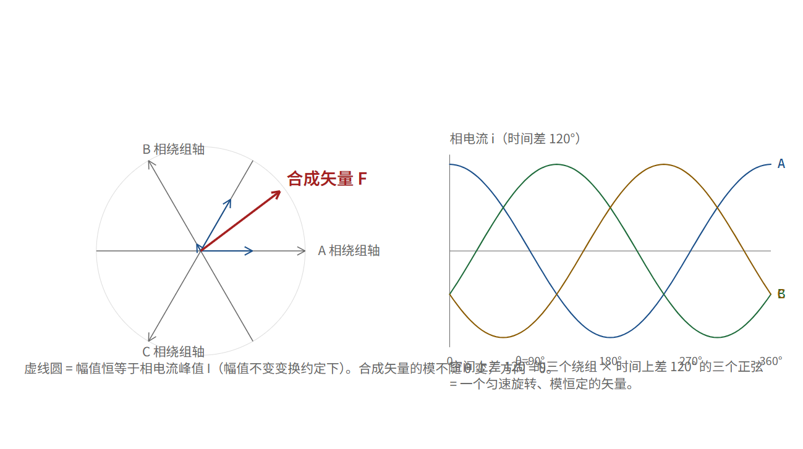

# 旋转磁场是合成出来的：三相、120°、以及为什么没有三次谐波

## 三个只能直着推的人，合出一个匀速画圆的力

上一章的结论是：要控制扭矩，就得让定子磁场始终垂直于转子磁场。但“垂直”意味着这个磁场得能指向任意方向，而且转子在转，所以它还得跟着转。

问题立刻变得很具体：定子上是固定的铜线圈，它们只能沿自己的轴线产生磁场，一根直线上的东西怎么会转？

答案是矢量合成。三个人站在互成 120° 的方向上推一个球，每个人只能沿自己那个方向直推（这叫脉振磁场——方向固定、大小随时间正负摆动）。但只要三个人的力气按正弦变化、且相位彼此差 120°，他们三个的合力就是一只手在匀速画圆。

这不是比喻，这是一次可以代数字的加法。这一章就代这一次。

> [!QUOTE]
>
> “Optimus will be an amazing surgeon in the future.”
>
> 埃隆·马斯克（Tesla / xAI；人形机器人 Optimus 的公开发言者） — 特斯拉 2025 年第三季度财报电话会议（36 氪英文版报道） — 2025-11-07（英文原句，经第三方报道逐字引用；本书未核对录音或视频原文）



## 一次加法

设三个绕组的轴线方向分别在与参考轴成 0°、120°、240° 的方向上，各自产生的磁动势沿自己那条线，大小正比于各自的电流。于是合磁动势是个二维矢量：

```text
F_合成 = i_a·(1, 0) + i_b·(cos120°, sin120°) + i_c·(cos240°, sin240°)
```

给三个正弦电流，彼此差 120°：

```text
i_a = I·cos θ
i_b = I·cos(θ − 120°)
i_c = I·cos(θ + 120°)
```

代进去，取 I = 10 A、θ = 37°（脚本 `foc_check.py rotating_field_peak()` 跑出来的）：

```text
i_a = +7.986 A
i_b = +1.219 A
i_c = −9.205 A
        ↓ 合成
(α, β) = (+7.986, +6.018)
|合成| = 10.0000 A
方向 = 37°
```

**合成矢量的模正好等于相电流的峰值 10 A，方向正好等于 θ。** 把 θ 换成 0°、91°、200° 再算，模仍然是 10.0000，方向跟着 θ 走。

这就是“合成任意方向的磁场”这句话的确切含义：**你不需要让线圈转，你只需要让三个沿固定方向摆动的量按 120° 的相位差摆动，它们的和就是一个转的矢量。** 而且这个矢量的方向、大小都是你可以任意指定的——指定方式就是指定那三个数。

顺便注意一个漂亮的性质：合成模是**常数**。三个脉振磁场各自一会儿正一会儿负，加起来却是一个长度不变的矢量在转。这不是巧合，是因为 120° 的空间分布配 120° 的时间相位，正好把二次项消掉了。这个“常数模”性质意味着磁场不会周期性伸缩，也就没有周期性的径向力——没有径向力，就没有那种“嗡嗡”的电磁噪声和振动。这是三相电机比单相安静的根本原因。

## 为什么是三相，不是两相、四相

两相正交绕组也能合成任意矢量，逻辑上完全够用。那三相好在哪？

第一，**谐波位置不同**。N 相对称绕组通 N 相对称正弦电流，合成磁动势的空间谐波落在 2N·k ± 1 次（k = 1, 2, 3…）。两相的谐波落在 3、5、7…；三相的落在 5、7、11、13…，**没有 3 次**（3 的倍数次在三相对称系统里是零序分量，星形接法且中点不引出时没有通路，压根流不起来）。

这个差别很值钱。5 次与 7 次这一对谐波会和转子基波相互作用，产生一个 6 倍电频率的扭矩脉动（7 − 1 = 6）——俗称齿槽感、低速抖动。人形机器人的踝关节要在低速下稳稳输出几十牛米，这个脉动直接进到你的力控误差里。

第二，**同样电流下铜的利用率**。三相对称时中点不用引出，只需要 3 根线、6 个开关器件就能独立控制那个二维矢量的两个自由度。两相要引出 4 根线（或者接受公共端带来的耦合），四相要 8 个器件换一点点谐波改善，收益递减。

第三，**历史惯性**。三相输电与三相感应电机共享同一套基础设施与制造产业链，绕组模具、驱动器、电流传感器、控制芯片全按三相做。机器人关节是这条产业链下游的一个客户，不是它的定义者。

需要诚实标注的是：以上三条是**电机学通识与行业判断** [行]，不是宇树的选型说明。宇树从未解释过为什么用三相 [未]——它大概也没觉得需要解释，因为整个行业都是三相。

## 三相到两相的那次换算，有个名字叫 Clarke

上面那个“三个数 → 一个二维矢量”的加法，工程上有个固定的写法。设三相电流 i_a、i_b、i_c，定义：

```text
i_α = (2/3)·[ i_a − ½·i_b − ½·i_c ]
i_β = (2/3)·(√3/2)·[ i_b − i_c ]
```

这就是 **Clarke 变换**（也叫 αβ 变换）。前面那个 2/3 系数是“幅值不变”约定的产物——它保证了我们上面那个漂亮结论：三相正弦幅值 I 时，|(i_α, i_β)| = I。如果你看到有的资料写 √(2/3)，那是“功率不变”约定，两个数都差一个常数因子，物理结论一样。

自检一下（`foc_check.py clarke_three_phase()`）：θ = 0 时 i = (10, −5, −5)，代入得 (α, β) = (10, 0)。α 轴与 A 绕组轴线重合，所以 A 相独占 10 安培时合成矢量正好指在 0°，模 10。对。

还有一个立刻能用的推论：因为 i_a + i_b + i_c = 0（平衡三相、星形无中点），**你只需要采样两相电流，第三相减出来**。所以真实的关节驱动板上通常只有两个电流采样电阻或者两个霍尔，而不是三个——省一颗器件，省一路标定，代价是三相不平衡时算不准。你在拆一块驱动板时看到“只有两相采样”，不是偷工减料。

## 到这一步，我们手上有什么、还缺什么

现在链条是这样：

```text
要多少扭矩  →  要多大的电流矢量、指哪个方向  →  三相电流各是多少
   （第 04 章）        （第 05 章）                    （本章）
```

看起来通了。但“三相电流各是多少”这个结论要落地，还差最后一件事：**谁去产生那三个按 120° 相位摆动的电流？**

你手上的器件是：一个直流电池（24 V、60 V、75 V，看型号），和每相上下两个开关。开关只有两个状态。没有“输出一个 7.986 安培”这种旋钮。

也就是说：**我们要用只有开和关的器件，造出连续可变的正弦电流。**

这就是下一章，也是你提到的那句话真正所在的位置——“改变外面电流导通的时间，可以合成为任意方向任意大小的磁场”。这句话里的“改变导通时间”，指的是脉宽调制；而它之所以合法，靠的是一个叫伏秒平衡（伏秒平衡 = 电感只记得电压对时间的积分，第 08 章）的东西。

## 类比，以及它在哪儿破

类比：三个人站在互成 120° 的方向上，各自拿一根只能沿自己那条线拉的绳子。每个人按同一个节奏、但彼此晚 1/3 个周期地用力拉。球被三个人同时拉着，却像是被第四个人拉着绕圈走。

**这个类比在哪里破**：三个人可以精确控制自己的力气，而开关不能。开关只能全通或全断，中间没有“用一半的力”。所以真实世界里那个“第四个人”根本不存在——存在的是一堆极快的开关动作，靠时间比例骗过负载。类比到“力气”这一层就断了，下一层必须换一套物理解释。

---

**一个可检验的说法**：三个空间上互差 120°、时间上互差 120° 的脉振磁动势，其合成矢量的模恒等于相电流峰值、方向等于电流相位角；且三相对称系统的空间谐波不含 3 次，最低为 5 次。

**证据等级**：合成矢量与幅值不变 Clarke 变换是电机学通识 [行]；“模恒为 10.0000”是 [算]（`foc_check.py`，θ 取 0°/37°/91°/200° 四点全过）；“没有 3 次谐波 ⇒ 没有 6 倍电频率扭矩脉动”是电机设计的通行结论 [行]；“宇树未解释为何用三相”是 [未]；“驱动板通常只采两相”是行业普遍做法 [行]，**本书没有拆开过任何一块宇树关节板，不能断言它用了几路采样**。

**可核对清单**：

- [ ] 跑 `python code/tools/foc_check.py`，看“07 三相合成幅值”那条在四个角度下是否都给出 10.0000
- [ ] 手算一次 θ = 0°：i = (10, −5, −5)，确认 α = 10、β = 0
- [ ] 找一块开源电机驱动板（ODrive、moteus 都是开源的）的原理图，数一数它有几路相电流采样，验证“只采两相”这个说法
- [ ] 检查你读过的任何一份中文 FOC 资料，看它的 Clarke 变换前面是 2/3、√(2/3) 还是 1，并确认它声明了变换约定

**下一章**：开关只有两个状态，却要给出一根连续变化的正弦电流。这一层的答案不是电气技巧，而是一条几何事实：在一个开关周期里，你只能平均出六边形内部的点。
