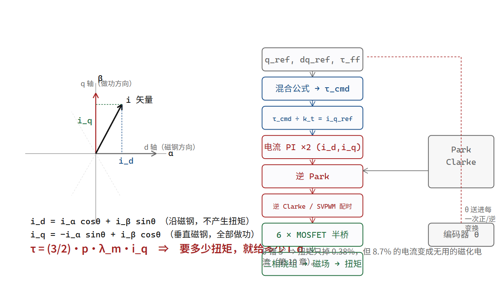

# Clarke 与 Park：把交流电机在数学上变成直流电机

## 你没法给一个旋转的东西设定“大小”

前三章把链条接到了这里：

```text
要多少扭矩 → 要多大的电流矢量、指哪个方向 → 三相电流各多少 → 开关怎么配时
```

还剩一个洞：**控制器怎么知道“现在该给哪三个数”？**

难处在于，那三个数是随时间正弦变化的。扭矩不变时，它们也在动；转得越快，动得越快。你要用一个 PI 环路去跟踪一条正弦曲线，就得给这个环路非常高的带宽——否则误差永远追不上。

这就是交流电机控制的全部困难所在：**在静止坐标系里，你要控制的东西一直在转。**

而解决办法只有一句话：**换一个跟着转的坐标系看它。**

> [!QUOTE]
>
> “human and then superhuman dexterity”
>
> 埃隆·马斯克（Tesla / xAI；人形机器人 Optimus 的公开发言者） — 马斯克在财报电话会议上讲 Optimus 手部设计（Business Insider 综述） — 2026-07-24（英文原句，经第三方报道逐字引用；本书未核对录音或视频原文）



## 那把跟着转的椅子

你坐在旋转木马上，朋友站在地面向你扔一个球，球绕着你匀速转。在地面坐标系里，球的位置是 (cos ωt, sin ωt)，你得不停地算三角函数。

现在你坐到球上一起转。在你眼里，球是静止的，位置是一个常数。

这就是 Park 变换。它做的唯一一件事是：把静止坐标系 (α, β) 里的矢量，投影到一对随转子电角度 θ 旋转的轴 (d, q) 上：

```text
i_d =  i_α·cos θ + i_β·sin θ        ← 沿转子磁钢方向的分量
i_q = −i_α·sin θ + i_β·cos θ        ← 超前磁钢 90° 的分量
```

（这就是一次二维旋转，没有任何新东西。符号约定各家不同，本书用的是“把静止矢量旋到转子坐标系”的标准形式。）

自检（`foc_check.py park_rotation()`）：θ = 0 时，(α, β) = (0, 10) 的矢量落在 (i_d, i_q) = (0, 10)。d 轴与 α 轴重合，所以 β 上的矢量与它垂直，全部是 q 分量。对。

**关键的一步是：θ 从哪来？** 从编码器。这就是整条链上最脆弱的一环，本章末尾会回到这里。

## 转完之后，世界突然安静了

在转子坐标系里看，永磁体的磁场永远是静止的，方向永远是 d 轴。于是第 05 章那个“要维持垂直”的要求，变成了一句不用跟踪任何东西的常数：

```text
要扭矩  ⇒ 只要 i_q
不要额外磁化 ⇒ 让 i_d = 0
```

**i_d 和 i_q 在稳态下都是直流。** 直流不需要跟踪正弦，一个普通的 PI 环路就能把它钉在给定值上，稳态误差可以为零（因为积分项会一直累加直到误差消失）。

这就是磁场定向控制的全部威力，也是它名字的准确含义：

> **FOC 不是“控制磁场”，而是“把坐标系定向在磁场上”。坐标一转，交流电机在数学上就退化成了直流电机——于是你可以用控制直流电机那套最朴素的方法来控制它。**

完整的执行顺序，一次中断里跑完（这是伪流程，不是任何厂商的代码）：

```text
1. 采两相电流 i_a, i_b（第三相 i_c = −i_a − i_b）
2. Clarke：(i_a,i_b,i_c) → (i_α, i_β)
3. 读编码器角 θ，Park：(i_α,i_β) → (i_d, i_q)
4. 两个 PI：i_d_ref − i_d → u_d ；i_q_ref − i_q → u_q
5. 逆 Park：(u_d,u_q) → (u_α, u_β)
6. 逆 Clarke / SVPWM 配时 → 六个 MOSFET 的占空比
7. 回到第 1 步
```

**注意第 4 步的输入 i_q_ref 从哪来**——它就是“你要的扭矩 ÷ k_t”。第 04 章那条式子在整张图的第 4 步接入。所以这张图不是“FOC 的原理”，它是“电流如何成为唯一旋钮”的完整证明。

## 为什么这套东西要在 20 kHz 的节拍上跑

PI 环路的带宽上限，由它能多快改变输出、以及它多久能知道一次结果决定。

- 你能改的只有占空比，而占空比一个开关周期只能改一次 → **环路更新率 ≤ f_sw**。
- 你能读的只有电流，而电流采样必须落在特定的时间窗里（下管导通、电流连续、避开开关沿）→ **一次测量要等半个到四分之一个周期**。
- 一个有纯延迟的一阶对象，可稳定的环路带宽大致在“延迟的倒数除以几”这个量级。

工程上的通行取值是：**电流环带宽 ≈ f_sw / 10 到 f_sw / 20** [行]。20 kHz 载波 ⇒ 电流环 1–2 kHz。

这个数字后面还要用两次（第 12 章的带宽阶梯、第 18 章的刚度上限）。现在先记住它的来源：它不是谁规定的，它是“你每秒只能改几次占空比、只能测几次电流”的直接后果。


### 这条 “f_sw ÷ 10 到 ÷ 20” 是从哪来的：延迟吃相位

第 09 章说电流环的上限由对象自己的节奏 τ_e = L/R 定，这一章又说约等于 f_sw ÷ 10 到 f_sw ÷ 20。
两个数说的是同一件事，但约束的不是同一个东西——得说清哪个才真正卡住你。

**τ_e 决定“你要费多大力去推”**：电流环要压的对象是一个一阶惯性环节，极点落在 1/τ_e。
想把闭环带宽推到极点之外就得靠增益硬顶，代价是对噪声的放大。这是“值不值得”的问题。

**延迟决定“你能不能站住”**：数字环里至少两段纯滞后。① 占空比在本周期写入、周期内平均生效
⇒ 平均滞后 T_sw/2；② 采样、算完、下一次写入 ⇒ 再吃一个 T_calc。合计 T_lag = T_sw/2 + T_calc。
纯滞后在频率 ω 处吃掉 ω·T_lag 弧度，**没有上限**——频率越高吃得越多。
电流环通常要留 45°（0.79 rad）以上的相位裕度，而被控对象那一极已经先拿走接近 90°，
于是留给滞后的预算只有 0.3–0.4 rad：

```text
ω_c · T_lag ≤ 0.35   ⇒   ω_c ≤ 0.35 ÷ T_lag
```

拿 20 kHz 开关频率、计算耗时 25 µs 的关节驱动板算（T_sw = 1 ÷ 20 kHz = 50 µs，半周期 25 µs）：

```text
T_lag = 25 + 25 = 50 µs
0.35 ÷ 50e-6 = 7,000 rad/s
7,000 ÷ 6.283 = 1,114 Hz　⇒　约 1.1 kHz
```

**两条理由给出的上限是同一个量级，但取小者才是约束。** 而且它解释了“1–2 kHz”这句话的隐含前提：
开关频率要在 40 kHz 上下、计算滞后要压到十几微秒——不是随便一颗 MCU 都能拿到 2 kHz 电流环。
这也把第 12 章那句“开关频率高，所以能调更大的 kp”从口号变成推导：f_sw 翻倍 ⇒ T_sw/2 减半
⇒ 允许的 ω_c 抬高 ⇒ 扭矩环更快 ⇒ 第 18 章那个软件弹簧才更硬。
反过来，第 18 章 ω_n ≤ ω_电流环 ÷ 5 里那个“除以 5”也有了出处：位置/速度环必须离电流环的
穿越频率足够远，否则它看到的不是一个听话的扭矩源，而是一个相位裕度正在被延迟啃掉的谐振体。

（45° 最小相位裕度是控制教材通行取值 [行]；**0.35 rad 这个预算是本书取的设计值**——被控对象那一极先拿走约 90°，若只留 45° 裕度，理论上可用到 0.79 rad，本书再让给 PI 零点与谐振约 20°，取 0.35 [算]；T_calc = 25 µs 与 f_sw = 20 kHz 是本书假设，
宇树未公布这颗驱动板的开关频率与中断耗时 [未]。示波器量一下 PWM 周期与“采样到写入”的间隔，
这两格就从算例变成实测。）
## 反过来说：θ 错了会怎样

第 05 章算过那张表，这里补上工程后果。编码器安装角偏了 δ，控制器以为的 d/q 轴和真实的 d/q 轴之间就差了 δ。你给 i_q_ref = 40 A，实际注入到真实 q 轴的只有 40·cos δ，剩下的 40·sin δ 变成了磁化电流。

| δ | 扭矩保留 | 无用电流 | 同扭矩下电流放大 | 铜损增加 |
|---|---|---|---|---|
| 1° | 99.985% | 1.7% | ×1.0001 | +0.03% |
| 5° | 99.62% | 8.7% | ×1.0038 | +0.77% |
| 15° | 96.6% | 25.9% | ×1.035 | +7.2% |
| 30° | 86.6% | 50.0% | ×1.155 | +33% |

（`foc_check.py angle_error_cost()` 加一列 1/cos δ 与 (1/cos δ)² − 1。）

这张表最重要的信息是：**5° 以内的装配误差，在“扭矩够不够”这一项上几乎测不出来。** 一台装配偏了 5° 的关节，能通过所有出厂测试，只会在客户手里连续满载时比别人热几度，然后磁钢慢慢退磁，k_t 慢慢下降，控制器为了维持扭矩继续加大电流，更热。这是一个正反馈，起点是一次装配。

所以真实的关节产品里，“零点标定”是一道工艺，不是一段代码：把转子锁定在已知电角度上，读编码器值，把这个差写进 Flash。这道工序做没做、做在产线还是做在装配后、精度多少，宇树全部未公布 [未]。

顺带解释一个你可能见过的现象：无刷电机有三根相线，接错任意两根会反转。为什么？因为你交换了两相，等于把合成的电流矢量镜像了一次，而控制器不知道——它算的 θ 还是原来的 θ。所以一个“跟着转的坐标系”如果转错了方向，你给的所有正扭矩都会变成负扭矩。**FOC 的全部正确性都建立在“我知道 θ”这一个假设上，而这个假设是会被装配、接线、标定破坏的。**

## 类比，以及它在哪儿破

类比：你没法用望远镜追一只悬停旋转的蜻蜓并量它的速度。于是你造一把椅子，以蜻蜓的角速度转，坐上去，它就是静止的——现在你可以慢慢量。Park 变换就是那把椅子，编码器就是告诉你该多快转的那个人。

**这个类比在哪里破三处**。第一，蜻蜓会自己变速，椅子必须跟着变，所以“转多快”这件事本身是实时输入，一旦它滞后，蜻蜓又动了。第二，你坐上去之后量到的“静止”是二维的两个数（d、q），而不是一个数——这两个数各自有各自的物理意义，一个做功一个不做功，这正是第 11 章的主题。第三，也是最要紧的一处：如果那个人报错了角度，你会以为蜻蜓静止、其实它在绕着你转，而且**你从椅子上完全看不出来**。

---

**一个可检验的说法**：磁场定向控制的本质是一次坐标旋转，它把“跟踪三相正弦”变成“稳住两个直流量”；因此电流环的可用带宽上限由开关频率决定（约 f_sw/10–f_sw/20），而整个方案的正确性完全依赖电角度 θ 的准确性——5° 的角偏只损失 0.38% 扭矩，却把 8.7% 的电流变成无用的磁化电流，且这一损失无法通过扭矩测试发现。

**证据等级**：Clarke/Park 变换式、dq 模型、PI 稳态零误差、电流环带宽与 f_sw 的关系，全部是电机控制通识 [行]；角度误差表是 [算]（纯三角函数，`foc_check.py`）；“宇树未公布载波频率、死区、零点标定工艺”是 [未]；“两相采样、第三相算出”是行业普遍做法 [行]。

**可核对清单**：

- [ ] 跑 `foc_check.py` 的“10 角度误差 5°”，确认 cos5° = 0.9962、sin5° = 0.0872
- [ ] 自己代一次 Park：θ = 90°、(α,β) = (0,10) 时应该是 (i_d,i_q) = (10,0)，确认“矢量与 d 轴重合时 q 分量为零”
- [ ] 数一遍那七步伪流程里，哪几步用到了 θ（第 3、5 步），从而确认“θ 错 ⇒ 变换和逆变换都错，且互相掩盖”
- [ ] 在任意一份开源电机固件（moteus、ODrive、SimpleFOC）里找到它的 Clarke/Park 实现，看它用的是 2/3 还是 1 的系数，再对照它的扭矩公式系数——验证“约定必须成对出现”

**下一章**：i_d 和 i_q 现在都清楚了。但为什么 i_d 一定要等于 0？什么情况下我们故意让它不等于 0，甚至让它为负？那个答案关系到人形机器人膝盖能不能在高速下还保住扭矩。
