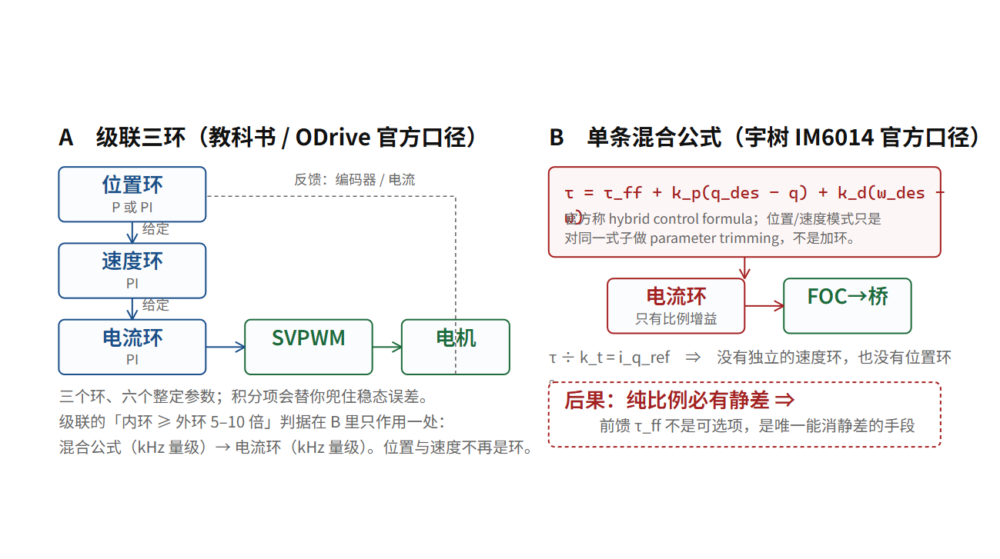

# 三个环其实是一个环：电流 → 速度 → 位置的带宽递减律

## 你写了“走到 0.5 米”，机器里最后剩下的是“40 安培”

一个上层规划器说：右膝，1.2 秒后到 60°。

这句话进入关节之后发生了什么？十个人里有九个会答“电机转到那个角度”。这个答案不算错，但它跳过了全部关键内容。真实发生的事情是一条**逐级翻译链**，每一级都在解决上一级解决不了的问题：

```text
"60°"（位置）
   ↓ 位置环：还差多少角度 → 该转多快
"1.8 rad/s"（速度）
   ↓ 速度环：现在转多快 → 该出多少力
"12 N·m"（扭矩）
   ↓ τ = k_t·i_q（第 04 章）
"18.8 A"（电流）
   ↓ Park + PI + 逆 Park（第 10 章）
"(u_d, u_q)"（电压矢量）
   ↓ SVPWM 配时（第 08 章）
“六个 MOSFET 的占空比”
   ↓ 死区、栅极驱动、母线（第 13 章）
“电流”
```

**注意这条链的终点和起点：位置请求最终变成了电流，而电流是这台机器唯一的旋钮（第 04 章）。所谓“位置、速度、扭矩”三种控制模式，不是三台不同的机器，甚至不是三种不同的算法——它们是同一个电流给定外面套了几层壳。**

只给电流给定 = 扭矩模式。再加一层速度环 = 速度模式。再加两层 = 位置模式。宇树电机手册里那三种模式，在这条链上就是“包了几层”的区别。

> [!QUOTE]
>
> “Progress on Optimus hardware and software continued in Q4, including the latest generation hand, robust locomotion and training on additional tasks, ahead of planned pilot production in 2025.”
>
> 埃隆·马斯克（Tesla / xAI；人形机器人 Optimus 的公开发言者） — 特斯拉 2024 年第四季度股东更新（公司自己发布的 PDF，逐字抽取） — 2025-01-29（特斯拉自己发布的股东更新原文（PDF 全文用 PyMuPDF 抽取，逐字核对））



## 为什么必须分三层，而不是一个大环直接算占空比

这是这一章真正要回答的问题。既然终点都是电流，为什么不写一个“角度误差 → 占空比”的函数，一步到位？

因为**这三个量的物理时间常数差了三到四个数量级**，而一个反馈环路的稳定带宽，不能超过它所控制的那个物理过程的速度。

| 被控量 | 载体 | 时间常数来自 | 典型量级 |
|---|---|---|---|
| 电流 i_q | 绕组电感与电阻 | τ_e = L/R | 零点几毫秒 → 带宽 1–2 kHz |
| 转速 ω | **负载**折算惯量（裸转子的 τ_m 只有几十微秒，见第 09 章） | τ_m = J/B 或 J/(k_t²/R) | 毫秒级到几十毫秒 → 带宽几十到几百赫兹 |
| 角度 θ | 负载惯量 + 减速器刚度 | 机械共振与摩擦 | 几十毫秒 → 带宽几赫兹到几十赫兹 |

（带宽数值是行业通识量级 [行]；宇树未公布任何一颗关节的 L、R、J [未]。）

如果你把三层合成一层，会发生什么？你会得到一个高增益的“角度→占空比”环路。而电流这个物理量对占空比的响应是**毫秒级**的，角度对它的响应是**几十毫秒级**的。你用毫秒级的执行手段去闭环一个几十毫秒的过程，中间那段时间里电流早已冲过目标值几十次，而你还没看见。结果就是超调、振荡、过流保护跳闸。

**级联（cascade）结构的作用，是让快的过程先自己管自己，慢的过程只把它当成一个“已经完成了的执行器”来看。** 电流环把“给多少电流”这件事做到几乎瞬时准确，速度环就可以假设“我下令要 12 牛米，就真的会有 12 牛米”，只管自己的事。

这条结构要求有一个可检验的形式：**内环带宽必须是外环的 5–10 倍以上。** 否则外环会把内环的动态当成未建模扰动，级联的假设就不成立，环路会互相干涉。

```text
电流环 1–2 kHz   ÷ 速度环 100–200 Hz   ≈ 10×  ✓
速度环 100–200 Hz ÷ 位置环 20–50 Hz     ≈ 5×   ✓
```

这也解释了为什么“提高开关频率”这件事会一路影响到你的关节能有多硬：f_sw 提高 → 电流环带宽可以提高 → 允许速度环更快 → 允许位置环增益更大 → 关节能表现出的等效刚度上限更高。**刚度不是软件参数，它的地基是半导体开关速度。**

## 宇树把哪一层交给了你

现在可以去看真实的接口了。宇树 SDK 里给关节下指令的数据结构（话题 `rt/lowcmd` 里的 `MotorCmd`），官方 IDL 一共七列 [厂]：

```text
uint8   mode      工作模式位
float32 q         目标角度
float32 dq        目标角速度
float32 tau       前馈扭矩
float32 kp        刚度
float32 kd        阻尼
uint32  reserve   保留
```

而在人形用的那套 `unitree_hg` 消息里，`motor_cmd` 与 `motor_state` 都是 **35 个元素的定长数组**——这一帧报文按最多 35 个关节设计，G1 的 23 或 29 个自由度都装得下 [厂]。

真正参与控制的是中间五列。请注意官方给其中两列起的名字：**kp 那一列在文档里叫 Stiffness（刚度），kd 那一列叫 Damping（阻尼）**。电机手册上控制指令列表的原文是 Torque, Angle, Angular Velocity, Stiffness, Damping [厂]；灵巧手文档里的反馈字段原文是 Joint Torque, Joint Stiffness Coefficient, Joint Damping Coefficient [厂]。**「关节是一个可编程的弹簧-阻尼器」不是本书的比喻，是宇树自己的字段名。**

还要小心一件事：官方在三个不同页面用了三套模式命名，本书不合并它们 [厂]。

| 出处 | 原文列出的模式 |
|---|---|
| 电机文档中心 mode.mode 位域（3 bit） | 0 locked；1 **FOC closed-loop**；2 encoder calibration；3~7 reserved |
| 电机文档中心 Control Mode 章 | Position / Speed / Damping / Torque / Zero torque |
| 电机产品页 Motor Control Instruction | Torque, Angle, Angular Velocity, Stiffness, Damping |

产品页那份列表里**没有 FOC 这个词**；FOC 只出现在位域（1 = FOC closed-loop）和 About 页的 FOC driver board。所以不要把三张表合成一句「控制模式：位置 / 速度 / 转矩 / FOC」——那是把工作模式位、驱动器模式、可给指令三个不同层次的东西压成了一层。

顺便把四合一的官方原文也记下来，它是全书出现频率最高的一个结构：M8010 是 a brushless motor, reducer, single-turn absolute encoder, and FOC driver board；IM6014 是 a brushless motor, planetary reducer, dual encoders, and FOC driver board [厂]。**注意第一颗是单圈绝对值，第二颗才是双编码器**——这个差别第 14 章要用。（双编码器 = 电机端与输出端各装一颗角度传感器，用来把减速器的空程量出来）

关节 MCU 每个周期执行的是这一行：

```text
τ_cmd = tau + kp·(q_ref − q_measured) + kd·(dq_ref − dq_measured)
```

然后 τ_cmd ÷ k_t = i_q_ref，进入第 10 章那七步。

**这一行公式是整章的落点，也是理解现代机器人关节的钥匙。** 它旁边还有一个更能说明问题的字段：状态帧 `MotorState` 里报上来的不是「测到的扭矩」，而是 **`tau_est`——估计扭矩**；同一帧还带着 `temperature int16[2]`（两路温度）与 `vol`（母线电压）[厂]。一个名字叫「估计」的扭矩字段，本身就是「这颗关节输出端没有力矩传感器」的最强旁证（第 14 章会把它接上准直驱那条线）。（准直驱 = 用较低的减速比，让电机端电流还能代表输出端力矩）

请注意这一行意味着什么：

一，**位置环和速度环都在关节里跑，不在你的主控上。** 整机侧的 `rt/lowcmd` / `rt/lowstate` 官方文档口径是 **500 Hz**，并且被 SDK 里的 `control_dt_ = 0.002`（2000 µs 线程）独立印证 [厂]；单颗电机的指令率也就是上面算出的那个 kHz 量级。而电流环需要 1 kHz 以上才够用——所以最里面那圈闭环必须发生在关节本地，总线只负责改给定值。这是「低层必须在关节里」的最硬理由。

二，**这一行就是阻抗控制的全部实现。** τ = kp·Δq + kd·Δω 是一个弹簧加一个阻尼器。你把 kp 调大，关节表现得像硬；调小，像软；kd 提供耗能。所谓“可编程刚度”不是修辞，是这个式子里那两个真的可以改的数。（第 18 章会算 kp 的上限由什么决定。）

三，**tau 是前馈项，它不进任何环路。** 这意味着上层可以直接绕过位置与速度，命令一个纯扭矩。这是所有“被推了一下先软后硬”这类行为的技术底座，也是把人摔伤的风险来源——一个能把 kp 设成 0、tau 设成 30 牛米的接口，本身就是一个安全问题（第 37 章）。

四，**注意这里没有 i_q。** 你无法直接命令电流。你命令的是扭矩，而扭矩到电流的那一步（除以 k_t）在关节内部完成，k_t 是多少、有没有温度补偿、掉多少，全部未公布 [未]。换句话说，宇树把第 04 章那条式子封在了黑盒里，把它的输入端（τ）留给了你。

## 一个必须更正的说法：宇树官方明说它**不是**级联三环

上面那张级联图是**教科书结构**，也是 ODrive 这类开源驱动器**真正在用的**结构。但把它安到宇树头上，是错的——而宇树自己在文档里说得非常明确。

**ODrive 的官方口径**（`docs/control.rst`）[查]（他方一手：这是 ODrive 自己的文档，不是宇树）：

> The motor controller is a **cascaded style position, velocity and current control loop**.

它是真级联：位置环 P、速度环 PI、电流环 PI，三环嵌套，环路周期恒定 125 µs（8 kHz）。

**宇树 IM6014 的官方口径**（文档中心）[厂]：

> The "Position Mode" and "Velocity Mode" of the Unitree IM6014 are **not the traditional cascaded three-loop architecture of servo drives**, but rather **parameter trimming based on a single hybrid control formula**.

以及：

> the IM6014 motor's underlying layer only provides a **current loop interface with proportional gain**；驱动 internally only performs **proportional operations and torque synthesis**, then directly hands it over to the **FOC current loop** for execution.
（顺带把第 10 章留的那个坑填上：官方口径是电流环**只有比例项**。纯 P 控制器消不掉一个持续存在的扰动，而这个扰动恰好就是反电势 (2/3)·k_t·ω——它随转速线性涨。后果是：转速越高，同一个电流给定换来的实际扭矩越偏低；第 08 章算过 24 V 母线下满扭矩时只剩 1.08 V 余量，所以这个偏差在高速段不是小数。这就是“P-only 换带宽”的代价，官方没有公布它怎么补 [未]。）

**把这两段话拆开看，宇树的架构是三件事：**

```text
① 只有一条公式：
      τ = τ_ff + k_p(q_des − q) + k_d(ω_des − ω)
   官方称之为「混合控制公式」（hybrid control formula）。

② 所谓位置模式、速度模式，只是把这条公式里
   q_des / ω_des / τ_ff 三个给定值按不同方式填数
   ——官方原话是 parameter trimming（参数微调），不是加环。

③ 公式算出 τ 之后，除以 k_t 得到电流给定，
   交给 FOC 电流环。而这一层官方说只有比例增益（P），
   没有积分项。
```

**于是本章前面那张图要改一个字：位置环与速度环不是“环”，是“一条公式里的两项”。** 它们没有积分、没有抗扰、没有各自的带宽，因此也**不满足**“内环比外环快 5–10 倍”那个级联判据——因为它们根本不是嵌套结构。

## 那级联判据错了吗？没有，它换了位置

级联要求仍然成立，只是它作用在**另一处**：

```text
真正的两级嵌套是：
   混合公式（在关节 MCU 里，随指令率跑）
        ↓ τ_cmd ÷ k_t = i_q_ref
   FOC 电流环（kHz 量级，第 10 章）
```

**只有这两级，而且第二级确实是快得多的那一级。** 位置与速度不再是环，它们退化成“给这条公式喂什么数”。

## 两种架构的取舍，可以并排讲

| | 真级联三环（ODrive 口径） | 单公式 + 电流环（宇树 IM6014 口径） |
|---|---|---|
| 位置环有没有积分 | 有（P 或 PI） | **没有**——位置误差只按比例出扭矩 |
| 速度环 | 独立 PI，有自己的带宽 | **没有独立环**，k_d 只是公式里的一项 |
| 稳态位置误差 | 积分项可归零 | **必然存在**（纯比例有静差），要靠 τ_ff 补 |
| 整定参数个数 | 6 个（三环各 P、I） | **3 个**（k_p、k_d、τ_ff） |
| 抗扰与模型误差 | 强（积分吸收） | 弱，**要求上层把前馈算准**（第 19 章逆动力学） |
| 稳定性裕度 | 需逐级检查带宽分离 | 只有一级分离要检查，**更不容易自激** |
| 适合什么 | 位置精度要求高的机床、点胶 | 力控与全身控制：**把误差换成扭矩，而不是换成修正** |

**这张表解释了第 18 章末尾那句话为什么在宇树身上格外重要：**

> 前馈负责“应该出多大力”，反馈负责“实际差了多少”。

在真级联架构里，即使你前馈给得很差，位置环的积分项也会慢慢把误差吃掉——**它能替你兜底。** 而在单公式架构里**没有积分兜底**：前馈给错，稳态位置误差就永久留在那儿，直到你把 k_p 提高（然后撞上第 18 章那三道天花板）。

**所以“宇树为什么把 τ_ff 单独列成一个字段、并且把它放在指令结构里”** ——因为在这套架构里，**前馈不是可选项，它是唯一能消除静差的手段。** 而它要求上层必须有一个足够准的逆动力学模型（第 19 章）。

**这是一个非常干净的因果链：架构选择（不用级联）→ 静差无处可消 → 必须给前馈 → 必须有逆动力学模型 → 模型不准就抖。** 第 19、22 章的所有麻烦，有一部分就是从这条链的第一环长出来的。

（**必须标注的边界**：上面那段官方原文是 IM6014 的文档。G1/H1/H2 用的关节电机是否同一架构，官方未说明 [未]。而 `unitree_rl_lab` 的 G1 配置里 `control.control_type = 'P'`（位置型混合控制）[厂]，与 IM6014 的口径一致，是间接旁证，不是直接证据。）

## 类比，以及它在哪儿破（补一条）

原来那个“方向盘→油门→喷油嘴”的三级类比，现在要打个补丁：**宇树的车没有独立的油门伺服和方向伺服，它只有一张公式：目标角度与当前角度差多少、目标速度与当前速度差多少，两笔加起来直接算出该踩多深。** 而它也不会自己慢慢修正——**你必须在踩下去的那一刻就把该用的力气算对。**

**这个类比在哪里破**：司机可以凭感觉补，而关节不能——它只有你填进 τ_ff 的那个数。
## 那 6000 Hz 到底是什么

这里必须做一次祛魅，因为厂商参数表上的这个数字极易被误读。

GO-M8010-6 官方标「通信控制频率 6000 Hz」、「RS-485 @4 Mbps、一总线最多 15 台」 [厂]。听起来像「每个关节每秒刷新 6000 次」。

这次不用估算——官方文档中心给了**真实帧长**：控制帧 17 字节（CRC 覆盖前 15 字节）、状态帧 16 字节（CRC 覆盖前 14 字节）、电机 ID 0~14 而 15 是广播且无响应、多字节小端 [厂]。拿它做带宽算术（`foc_check.py bus_budget()`）：

```text
下行  15 台 × 6000 Hz × 17 B × 8 = 12.24 Mbps
上行  15 台 × 6000 Hz × 16 B × 8 = 11.52 Mbps
合计  23.76 Mbps ÷ 官方 4 Mbps = 5.9 倍
```

**差 5.9 倍，全双工全量交换不可能。** 把算术反过来做，答案更有意思：

```text
4 Mbps ÷ ( 15 台 × (17 + 16) B × 8 ) = 1010 Hz
```

**4 Mbps 的 RS-485 挂满 15 台、全双工，物理上限就是约 1 kHz。** 而宇树自己在 Z1 机械臂的产品页上把 Control Frequency 标成 1 kHz [厂]——两条来自不同页面、不同年代的官方数字，被一次除法接在了一起。这不是巧合，是同一条带宽约束在两个产品上的表现。

同一套算术用在 IM6014 上（官方帧长 20 B 下行 / 26 B 上行，6 Mbps，标称最大轮询 10000 Hz）：15 台全双工需要 55.2 Mbps，是 9.2 倍；反过来 6 Mbps 最多支撑 1087 Hz [厂][算]。方向完全一致。

这条推算仍有一个诚实的限制：**「通信控制频率」这个中文词组，官方页面没有给严格定义** [未]。所以本书不下「宇树标错了」的结论，只给两条判据：一，任何一体化关节的「通信频率」和「电流环频率」是两个不同的东西，看到前者不要当成后者；二，如果它被读成「15 台同时全双工 6 kHz」，那就与官方自己公布的帧长和波特率互相矛盾，而读成约 1 kHz 不矛盾。

电流环在关节 MCU 本地跑，与总线无关；总线只决定你多快能改它的给定值。

## 频率阶梯：一台人形上真实存在的六个数

把全书出现过的频率排在一起，你会第一次看见这台机器的完整节拍：

```text
20 kHz      MOSFET 开关（量级，宇树未公布 [未][行]）
 1–2 kHz    电流环（= f_sw/10–20，[行]）
 400–6000   关节指令刷新（[厂] 口径待澄清，见上节）
 ~500 Hz    整机低层状态/指令话题（Go2 上实测过；人形侧未逐项公布 [厂][未]）
 1 kHz      全身控制 / QP 回路的通行量级 [行]（全身控制 = 一次求解里同时决定所有关节该出多大力，并把脚与地面的接触约束一起算进去）
 50 Hz      RL 策略输出节奏 [厂]（unitree_rl_gym 的工序口径）
 5–10 Hz    VLA 模型（第 26 章的带宽算术给出上限）
```

**这张表里最该记住的不是具体数字，而是它的形状：从上到下每格差 3–20 倍，而每一格都受一个不同的物理量限制。** 最上面那格受半导体限制，中间受电感与惯量限制，下面受重力限制，最底下受内存带宽限制。你不能通过“优化算法”跨越任何一格——你只能换硬件（往上）或者换任务定义（往下）。

这也终于回答了第 00 章那个问题：大脑和关节之间相差 2400 倍，中间靠什么接上。答案是：**靠这条级联链，每一环替上一环把快的那部分做完，每一环只慢 3–20 倍。** 2400 倍不是一次跳过的，是六级台阶走下来的。**顺带把口径钉住**：这六级不是同一根轴——表里“指令刷新 6 kHz”与“全身控制 1 kHz”是**更新率**，而电流环 1–2 kHz、速度环一两百赫兹是**闭环带宽**，两者单位一样、含义不同，所以相邻两格的比值会同时出现 20 倍与 0.5 倍这种“向上”的数。**读这张表要读落差的总量级，不要读每一格。**

## 类比，以及它在哪儿破

类比：一家公司从 CEO 到车间。CEO 说“这个季度交付十万台”（位置给定），部门拆成周计划（速度给定），班组拆成每班动作（扭矩给定），工人手里只有一把扳机（电流）。每一级都比上一级快 5–10 倍，且每一级都假定下一级“会照做”。

**类比在哪里破**：公司里如果某个基层不照做，上级要到周报才知道；而级联控制里，内环的响应速度必须显著快于外环，**否则外环的假设就是假的**。真实机器人里，一旦负载惯量突然变化（摔了一跤、手里东西掉了、齿轮卡住），内环的动态慢到不满足 5–10 倍，外环立刻开始震荡。这就是“机器人突然抖起来”最常见的解释——不是算法坏了，是那条带宽分离假设在那一刻不成立了。

---

**一个可检验的说法**：位置、速度、扭矩三种模式是同一条级联链上「包了几层」的区别，链的终点都是 q 轴电流；级联成立的必要条件是内环带宽 ≥ 外环 5–10 倍；而 GO-M8010-6 的「6000 Hz 通信控制频率」与官方自己公布的「15 台 / 4 Mbps / 17+16 字节帧」不能同时成立为全双工全量交换（差 5.9 倍），把算术反过来得到的 1010 Hz 正好落在官方 Z1 页标的 1 kHz 上。

**证据等级**：级联结构与带宽分离判据是控制工程通识 [行]；`MotorCmd` 七列、`MotorState` 的 `tau_est` / 双温度 / 电压、35 元素定长数组，全部 [厂]（官方 `unitree_ros2` 的 `unitree_hg/msg/MotorCmd.msg`、`MotorState.msg` 与 SDK 生成的 `unitree/idl/hg/MotorCmd_.hpp` 可直接读）；三张模式表分别 [厂]（文档中心 8/106、8/107 与产品页）；「6000 Hz / 15 台 / 4 Mbps / 17 B / 16 B」是 [厂]，「23.76 Mbps / 5.9 倍 / 1010 Hz」是 [算]（`foc_check.py bus_budget()`）；`rt/lowcmd` 500 Hz 是 [厂]（文档口径）并被 [算]（control_dt_ = 0.002）印证；频率阶梯里未另标者为 [行]。

**可核对清单**：

- [ ] 跑 `foc_check.py` 的“27 总线带宽 M8010”，确认 23.76 Mbps、5.9 倍、1010 Hz 这三个数
- [ ] 打开 `unitree_ros2` 里的 `unitree_hg/msg/MotorCmd.msg`，数一遍字段是不是 mode / q / dq / tau / kp / kd / reserve 七列，并确认里面**没有电流字段**
- [ ] 打开同目录 `MotorState.msg`，找到 `tau_est` 这个字段名，想一想 est 这个前缀意味着什么
- [ ] 在宇树 SDK 源码里找到 lowcmd 的关节结构定义，数一遍字段是不是 q / dq / kp / kd / tau 五个，并确认里面没有电流字段
- [ ] 用你手里任何一颗一体化关节的参数表，检查它标的“控制频率”是通信口还是环路，判据就是本章那条带宽算术
- [ ] 想清楚为什么“提高开关频率”最终会让你按压弹簧时能调出更高的 kp

**下一章**：链条到这里已经通了——从角度请求一直到栅极占空比。但有一件事我们一直在跳过：控制器凭什么知道 θ？它凭什么知道转子此刻朝哪儿？下一章去看那颗 15 位的编码器，以及它前面那个更硬的东西：齿隙。
