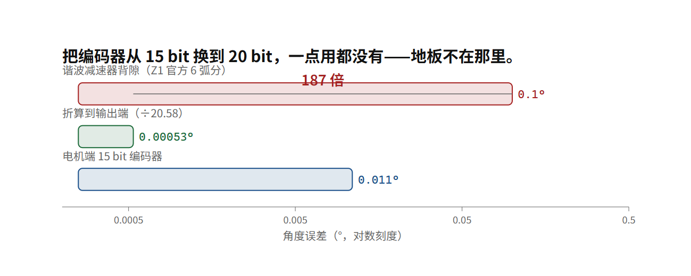

# 编码器、齿隙与准直驱：为什么 G1 用 20.58:1 行星而不是谐波

## 你能测到 0.011°，但你的关节能撒谎 0.1°

第 10 章留了一个洞：Park 变换需要电角度 θ，而 θ 来自编码器。这一章去看那颗编码器，然后立刻去看一个会把它彻底作废的东西。

宇树 M8010 与 IM6014 官方都标 **15 bit 绝对值编码器** [厂]。做一次除法：

```text
360° ÷ 2¹⁵ = 360 ÷ 32768 = 0.010986°  ≈ 0.011°（约 40 弧秒）
```

再核对一下指令侧。IM6014 协议文档里位置字段的量化写得很明确：**32768 / 2π = 1 rad**，也就是 int32 位置指令的最小刻度就是 2π/32768 rad = 0.011° [厂]。**指令分辨率与编码器分辨率是同一个数**——你下的位置指令再细也不会被实现，因为协议本身装不下。

这个 0.011° 听起来非常好。一台 1.32 米的人形，脚尖离转轴约 0.6 米，0.011° 对应的弧长是：

```text
0.6 m × 0.011 × π/180 = 0.12 mm
```

零点一毫米。够细了吧。

现在看第二行数据。Z1 机械臂的官方参数表里，谐波减速器那一栏写着：**减速比 60+，Backlash ～6 arcmin** [厂]。6 弧分 = 0.1°。

把两件事放一起（`foc_check.py resolution_vs_backlash()`，取 G1 拆解口径的 20.58:1）：

```text
电机端编码器：0.010986°
折算到输出端：0.010986 ÷ 20.58 = 0.000534°
谐波背隙：0.1°

0.1 ÷ 0.000534 = 187 倍
```

**齿隙是编码器分辨率的 187 倍。** 你的传感器能看见 0.0005°，你的传动链允许你撒 0.1° 的谎。（齿隙 = 输入端转了一小段而输出端不动的那段空程，行业里也叫回差或背隙）

这就是“精度”这件事的真实结构：**系统的精度不是由最精密的那个零件决定的，是由最粗糙的那个环节决定的。** 而齿轮箱的齿隙恰恰是最难做小、最容易随磨损变大的那个环节。你把编码器从 15 bit 换到 20 bit，一点用都没有——地板不在那里。

> [!QUOTE]
>
> 四足机器人是一个全新的品类，有些零部件，你想采购也买不到……
>
> 王兴兴 — 投中网（同上，来源 B） — 页面 2025-08-07；访谈本体约 2020 年前后（早年访谈转写）



## 齿隙为什么骗人：一段“允许空转”的对话

行星和谐波减速器都有回差：输入端转了一小段，输出端不动。原因是齿与齿之间必须有间隙才能装配、才能容润滑油、才能不卡死；而这个间隙意味着“改变方向的那一小段行程”是免费的。

```text
你让输出端往回走 0.05°：电机转了，编码器读数变了，输出端一动没动。
```

请注意这件事对第 04 章那条式子的打击。我们说过“用电流就能知道扭矩，不需要力传感器”。但那是**转子端**的扭矩：

```text
τ(转子) = k_t · i
τ(输出) = k_t · i · N · η
```

那个 η（效率）里包含减速器的摩擦。而摩擦在两个方向上符号相反——它不是“损耗掉一个固定比例”，它是“先吃掉一个固定阈值，剩下的才传递”。于是：

```text
低减速比：τ(摩擦) ÷ τ(输出) 很小  ⇒ 电流推出来的输出扭矩很准
高减速比：τ(摩擦) ÷ τ(输出) 很大  ⇒ 电流推出来的输出扭矩完全不可信
```

**这就是准直驱的全部逻辑。** 它不是为了“更直接地驱动”，它是为了让第 04 章那条式子在输出端还成立。（准直驱 = 减速比压到远低于谐波的 60–160，用更大的电机换回齿隙与摩擦的小占比）

## 官方数据自己完成的证明：一颗电机，两个齿轮

现在用宇树自己公布的数，把 τ(输出) = τ(转子) × N 验一遍。

`unitree_rl_lab` 的 G1 配置文件里，关节电机按型号分组，而**型号名里就带着减速比** [厂]：

| 官方电机型号 | 减速比 | 官方 effort 限幅 | effort ÷ 减速比 = 转子侧 |
|---|---|---|---|
| N7520-14.3 | 14.3 | 88 N·m | **6.15 N·m** |
| N7520-22.5 | 22.5 | 139 N·m | **6.18 N·m** |
| N5020-16 | 16.0 | 25 N·m | 1.56 N·m |
| W4010-25 | 25.0 | 5 N·m | 0.20 N·m |

（`foc_check.py gear_ratio_consistency()` 复算。）

看前两行。**同一台 φ75×20 的电机（型号名里的 7520），配 14.3 和 22.5 两种减速比，输出限幅分别是 88 和 139 N·m，而反推回转子侧是 6.15 与 6.18 N·m——相差 0.4%。**

这是一条不需要本书做任何假设的证明：宇树自己的两组官方数字，用一次除法就能对上，对上的精度是 0.4%。它同时说明：

- G1 的膝关节和髋侧摆关节用的是**同一颗电机**，输出差 58% 全靠那一级齿轮；
- 型号命名是可读的：`7520` = 直径约 75 mm、叠厚约 20 mm；后面的数字 = 减速比；
- 转子侧 6.15 N·m 这个数，与第 04 章算出的 M8010 转子侧 3.7–4.0 N·m 同数量级，只是更大一号的电机。

**而“更大一号”这四个字就是代价。** 想把 22.5:1 换成 14.3:1 来提高透明度、减小齿隙，你就必须让电机自己出更多扭矩，于是电机更大、更重、更热、更贵。准直驱不是免费的午餐，它是把代价从减速器搬到了电机上。（力透明度 = 你在电机端测到的量，有多接近输出端真实发生的力；齿隙与摩擦会把它糊掉）

## 宇树自己承认过这件事

Z1 机械臂产品页有一条脚注，原文是：

> Since the reduction ratio used by each joint is relatively low, the position control stiffness of the whole machine is low. If the control mode is not optimized, there will be large position control error and shaking when the manipulator moves. [厂]

翻成中文：**因为每个关节用的减速比都比较低，整机的位置控制刚度就低；如果控制模式不优化，机械臂运动时会有较大的位置控制误差和抖动。**

这是全书我最喜欢的一句厂商自陈，因为它把一条因果链用一句话讲完了，而这条链本书要用十章讲：

```text
低减速比 → 输出扭矩小 → 想扛同样的负载就得让电机多出扭矩 → 电流大 → 发热
                ↓
        齿隙与摩擦占比小 → 电流能代表输出力矩 → 可以不做力传感器
                ↓
        但位置环的等效刚度低 → 不优化就抖
```

**同一件事的两面。** 低减速比同时给了你“能感知力”和“站不硬”。而 Z1 是机械臂（它不需要扛整机重量），G1/H1 是人形（每条腿都要全程扛 35–70 公斤）。所以人形上这个取舍比机械臂上更狠。

## 刚度上限还有一个来源：指令字段的量程

第 12 章说 kp 那一列官方叫 Stiffness。那它能设多大？

官方协议文档给了范围。M8010 的 kp 量化写作 `raw = (k_p / 25.6) × 32768`，**允许范围 0.0 ≤ k_p ≤ 25.599**；IM6014 的 STM32 例程参数表里输出侧 Kp 范围是 **0 ~ 410.725**、Kd 是 **0 ~ 102.681** [厂]。

拿它做一次除法（`foc_check.py stiffness_limit()`）：

```text
M8010：  23.7 N·m ÷ 25.599 N·m/rad = 0.926 rad = 53.0°
IM6014： 34.4 N·m ÷ 410.725        = 0.084 rad =  4.8°
```

意思是：**在 M8010 上，如果你想让关节在输出满扭矩时只偏离目标 1°，你需要的 kp 是 23.7 ÷ 0.0175 = 1355 N·m/rad，而协议只让你写到 25.6。** 换句话说，M8010 的 kp 量程只够支撑“满扭矩时偏 53°”这种软度。IM6014 的量程宽 16 倍，所以它能硬得多。

所以“这个关节能调多硬”这件事，第一层限制不是控制理论、不是电流上限，**是那个 float32 字段被厂商量化到了什么范围**。这是一个非常工程化的事实：你的物理能力被一个协议字段定义卡住了。

（注意：G1/H1 整机用的关节电机不是 M8010，其 kp 量程官方未公布 [未]。这里给的是官方唯一公布了两颗型号量程的对比，用来说明“量程会卡人”这件事的存在，不是 G1 的能力。）

## 双编码器（转子端与输出端各一颗角度传感器，两数之差就是齿隙与弹性变形的实时读数）为什么重要

M8010 是 **single-turn absolute encoder**（单圈绝对值），IM6014 是 **dual encoders**（转子端 + 输出端），官方 About 页的原文就是这两句 [厂]。整机页对 AS2/G1/H2/R1 只说“双编码器”，**单圈还是多圈、输出端几位、精度多少，全部未公布** [未]。（双编码器 = 转子端与输出端各一颗，两数之差就是齿隙与弹性变形的实时读数）

为什么要在输出端再放一颗？因为两颗编码器之差，就是齿隙与柔性的实时读数：

```text
θ_输出实测 ≠ θ_电机 ÷ N     当且仅当  齿轮处于空程，或者弹性件被扭了
```

有了这个差，控制器第一次能知道“我现在在不在撒谎区间里”。没有它，你只能假设传动是刚的、无间隙的——而第 14 章开头那 187 倍告诉你，这个假设错得有多离谱。

代价也很实在：输出端一颗编码器意味着关节多一道密封、多一根线、多一次标定、多一份钱。这就是为什么它是“新一代”才有的配置。

## 于是两条路线分开了

现在可以把第 04 章那张表补完，并且解释一个真实的行业分歧：

| | 准直驱 + 电流估力（宇树 G1 走的路） | 高减速比 + 力矩传感器 |
|---|---|---|
| 减速比 | 14.3–25（G1 官方型号名）／拆解口径 20.58 [厂][拆] | 60–160（谐波） |
| 齿隙 | 小 | 大 |
| 摩擦占输出扭矩比 | 小 ⇒ `tau_est` 可用 | 大 ⇒ 必须实测 |
| 位置刚度 | 低（Z1 官方脚注自陈） | 高 |
| 同样输出扭矩需要的电机 | 更大更重 | 更小 |
| 每关节成本 | 少一颗传感器 | 多一颗（国产六维力已到约 ¥5,000 量级 [查]） |
| 抗冲击 | 好（齿隙与低减速比反而成了缓冲） | 差（谐波是薄壁柔轮，冲击下会坏） |

同期另一家厂商的整机规格里写着“全关节力矩传感器，分辨率 ≤0.02 N·m，采样 ≥5 kHz” [查]。两家不是谁笨，是在同一组物理约束下选了不同的那一头：**宇树把预算和重量押在电机上，另一家押在传感器上。**

而 `MotorState` 里那个叫 `tau_est` 的字段（第 12 章）说明宇树选的是前者——它上报的是估计值，不是测量值 [厂]。

## 如果非要装力传感器，它靠什么工作

第 04 章那张表里有一行“传感器本身温漂、串扰、零点、易碎”，本章的路线表又抄了一遍“约 ¥5,000/台”，两个词都没被拆开过。这一节把它们拆开，同时把边界钉死：坤维、蓝点、宇立的型号、贴片数量、耦合与温漂指标、报价，本书没有逐条核到它们自己的手册，所以一个都不写；能核到的只有媒体口径那句价格 [查]，而它最容易过期。第 04 章那行里另一个名字“磁弹性元件”走的是完全不同的物理（应力改变铁磁材料的磁致伸缩各向异性，于是要靠线圈或霍尔元件去读），本书没有可核的器件级材料，本节也不讲它——**这一节的六个新名字全部属于应变片这一条路线**。

### 力是怎么变成电阻的

弹性体（传感器里被设计成“只弹不塑”的那段金属：加载变形，卸载必须原样回来）被压时，它表面伸长一点点，这一跳靠胡克定律：

```text
σ = E · ε        应变 ε = 应力 σ ÷ 杨氏模量 E
```

σ 是应力（N/m²），ε 是应变（无量纲，m/m，伸长除以原长）。再往下追一句：那 E 又靠什么？靠晶格原子间距的势能曲率，所以它是材料常数，不是你设计得出来的。那 ε 为什么只能有千分之几？因为弹性体必须留在弹性区间里，而这个区间的高度是“屈服强度 ÷ E”给的，常用结构金属在 10⁻³ 量级 [行]。**信号天生就小，而且小在材料上，不是电路能改的。**

把这一小段伸长换成电阻的是应变片（strain gauge：几微米厚、绕成栅状的金属箔，用胶贴在弹性体上，跟着它一起变形）：

```text
ΔR/R = K · ε        灵敏系数 K 无量纲；金属箔约 2，半导体大两个数量级但热稳定性差 [行]
```

K 约 2 是两件事的合计：一半多一点来自几何（拉长的同时横向变细，电阻按长度除以截面积走），剩下来自电阻率随晶格间距变化——而这两件事对温度的反应不一样，这句话待会儿要用。

### 惠斯通电桥为什么是四个电阻而不是一根

千分之二的电阻变化，ADC 怎么看得见？靠惠斯通电桥（Wheatstone bridge：四个电阻围成菱形，从一对对角上取电压差）。等臂、小变化下：

```text
U_o/U_ex = (1/4) · (ΔR1/R − ΔR2/R + ΔR3/R − ΔR4/R)
```

U_ex 是激励电压（V），U_o 是桥输出（V）。单臂工作时，0.2% 的电阻变化只换来 0.05% 的 U_ex；四臂全工作、把受拉的接进相对臂，四项同号相加，输出乘 4，得到 0.2% 的 U_ex——**行业那句“2 mV/V”就是 K·ε = 2×10⁻³ 换了一种单位写** [行][算]。温度为什么能被消掉？因为**温度对四条臂同号、应变对相邻臂异号，而桥只做减法**：同号那份被减掉，异号那份被加倍。那这个抵消又靠什么？它的前提是四条臂真的对称——残余来自贴片栅丝与弹性体线膨胀系数的失配（“温度自补偿应变片”这类器件就是为它存在的），以及 E 自己的温度系数。温度与信号谁大，拿第 13 章那个铜的数（+0.393 %/°C [行]）算一遍：

```text
ΔT = 0.002 ÷ 0.00393 ≈ 0.5 °C
```

不到半摄氏度的温差，电阻变化就顶得上满量程应变给的电阻变化。**单臂桥不是精度差一点，是不能用。**（真实器件用的是低温度系数的合金箔，这里只借铜的数量级说明为什么必须四条臂。）

### 六个载荷 → 六组符号 → 一张 6×6 矩阵

腕上那颗六维力要交六个数，而它身上只有“某处伸长了多少”这一种信息。中间这一步靠什么？靠**六个载荷在每个贴片上留下的符号模式互不相同** [行]：

| 施加的载荷 | 弹性体上的应变长什么样 | 于是贴片要怎么贴 |
|---|---|---|
| 沿轴的力 | 纵向受压、横向胀粗，两个符号相反 | 纵向一片、横向一片，接进相邻桥臂正好相加 |
| 弯矩 | 一侧受拉、对面那侧受压，周向反对称 | 对称两侧各一组，取差 |
| 扭矩 | 纯剪切，主应变方向在 ±45° 上 | 正着贴的片读到零，斜 45° 的片才有读数 |

把每组输出排成向量 ε（m 维），六个载荷排成 F（单位 N 与 N·m），小变形下叠加成立，于是一张常数矩阵出现：

```text
ε = S · F        S 是 m×6 模式矩阵，一列 = 一个载荷的单位响应
F = D · ε        D = S⁺（m=6 时是 6×6 的逆，m>6 时是最小二乘伪逆）
```

D 就叫解耦矩阵（decoupling matrix：把 m 路电压还原成六维力/力矩的那张常数表），“标定”这两个字的物理内容就是拿一组已知载荷把 D 逐元素测出来。为什么 D 可以是常数？追问一句“那这又靠什么”，答案是**它只在弹性区间内线性**（又是前面那个 10⁻³ 上限）。所以超量程的后果不只是“会坏”：**压进塑性之后，这张标定表描述的那根梁已经不存在了，解耦矩阵当场失效。** 这是第 04 章那个“易碎”最准确的说法。

### 串扰、维间耦合、温漂，都是这张矩阵的性质

维间耦合（cross-axis coupling，行业里也叫串扰——一根轴上加载、另外几根轴也报数）不是噪声，它就是 D 的非对角元：把只有 F_z 的真实载荷代进 F = D·ε，只要第 x 行在 ε_z 那列不为零，F_x 就报出一个不存在的数。条件数（condition number：κ = σ_max ÷ σ_min，同一张矩阵最大与最小奇异值之比）回答的是“这张矩阵逆得稳不稳”，线性代数给的界是 ‖δF‖ ÷ ‖F‖ ≤ κ · ‖δε‖ ÷ ‖ε‖，翻译成人话：**贴片与电压链上 0.1% 的误差，最坏方向会被放大成 κ × 0.1% 的力误差；κ = 20，就是 2%。** 耦合不是供应商给你的指标，是你自己的贴片布置决定的矩阵性质。

温漂在这张矩阵上有两个入口，而不是一回事：

| 温漂来源 | 作用在哪一维 | 空载时看得见吗 | 能不能靠标定消掉 |
|---|---|---|---|
| 桥臂电阻随温度涨（金属是正温度系数） | 零点 | 看得见，空载也在漂 | 一次零点校准就能减掉 |
| 弹性模量 E 随温度降（同一根棒热了更软） | 灵敏度 | 隐形，漂多少正比于当前载荷 | 减载校准碰不到它 |

本书说这两条相反，指的是**作用点相反**：一次标定只能钉死其中一条，而厂商那种“温度范围内 ±X% F.S.”的写法，是把两条打包成一个数 [行]。

### 把那张账补完：2% 的耦合值多少牛

| 路线 | 误差来源 | 折算成满量程百分比 | 作用在 500 N 的量程上 |
|---|---|---|---|
| 传感器 | 维间耦合（κ = 20 ⇒ 2%） | 2% | F_err = 500 × 0.02 = 10 N |
| 电流估力 | 摩擦阈值 Fs = 2.4 N·m（N7520-22.5，官方训练仓库），该档满量程 139 N·m | 2.4 ÷ 139 ≈ 1.7% | 约 8.5 N |
| 电流估力 | k_t 温漂（第 36 章：80 °C 温升 ⇒ 同电流扭矩少 8.8%） | 8.8% | 约 44 N |

（[算]。三个来源分别是上面那条 κ 的界、`foc_check.py` 的 UNITREE_ACTUATORS 表、第 36 章的温升链。）口径要说死：**这张表只比“某一瞬间的绝对误差”，不是两条路线的总成绩。** 而在这个口径上两条路线打平。真差别全在误差的性质：串扰要修正，必须先知道另外五根轴此刻受了多少载，而那恰恰是这次测量本来要告诉你的事，能不能解开全看 κ；摩擦有结构、与换向方向相关、可以被前馈吃掉（和本章“齿隙的谎是有结构的”同一条道理），k_t 温漂慢、单调，可以拿温度测点当健康指标盯（第 36、38 章）。

那传感器到底买到了什么？**带宽和分辨率，不是精度。** 同期那家厂商的整机口径写着“分辨率 ≤0.02 N·m，采样 ≥5 kHz” [查]，而本章那条 0.19 rad/s 的速度噪声，到第 18 章会变成一条“不装传感器时能检出的最小力矩”的账，落点在 2 N·m 量级——**与 0.02 N·m 差两个数量级**，那不是靠更好的滤波器追得上的——本章的分歧就在这里：一边把钱押在电机上，一边押在传感器上，两边都付全额。

## 类比，以及它在哪儿破

类比：齿轮箱是一段允许撒谎的对话。你对翻译说“往右转 0.05°”，翻译自己动了，但站在门另一边的听众一动没动——而你只能通过听众来确认指令被执行了。齿隙就是这段“我听了但没做”的空程。

**这个类比在哪里破**：翻译的谎是随机的，而齿隙的谎是**有结构的**——它只在换向时出现，且量基本固定。这意味着它可以被建模、被补偿（用双编码器测出来，或者用方向相关的偏置补掉）。所以真实工程里齿隙不是无解，它只是“要额外花一份成本才能不管它”。而准直驱路线做的正是这件事：**把成本花在让齿隙小到可以忽略上，而不是花在测量它上。**

---

**一个可检验的说法**：G1 官方关节电机家族里，N7520-14.3 的 88 N·m 与 N7520-22.5 的 139 N·m 反推转子侧分别是 6.15 与 6.18 N·m，相差 0.4%，构成 τ(输出) = τ(转子) × 减速比 的一条官方自证；同时 15 bit 编码器折算到 20.58:1 输出端是 0.000534°，而谐波背隙 6 弧分 = 0.1°，是它的 187 倍，所以齿隙而非编码器决定位置精度地板。

**证据等级**：15 bit、single-turn / dual encoders、32768/2π = 1 rad、kp 范围 0–25.599 与 0–410.725、Z1 的 60+ / 6 arcmin / 0.2 N·m / 1 kHz、Z1 那条脚注原文，全部 [厂]（产品页与文档中心可逐字核对）；N7520-14.3 等型号名与 effort 限幅是 [厂]（`unitree_rl_lab` 配置文件）；187 倍、0.4%、53.0°、4.8°、0.12 mm 是 [算]；20.58 速比与主承载关节 1.1 kg 是第三方拆解 [拆]，**与官方型号名里的 22.5 不一致，本书两条都列，不取平均**；G1 关节内是否有输出端力矩传感器官方从未说明 [未]，`tau_est` 是最强旁证但不是直接证据。

新增那一节的证据等级单独说清：电桥输出式、灵敏系数 K 的构成、全桥 2 mV/V 与 K·ε 的等价、六个载荷的符号模式、解耦矩阵与伪逆标定、条件数误差界、温漂的两个入口——**全部是传感器与力学通识 [行]，不是任何一家厂商的器件事实**；由通识推出来的 ΔT ≈ 0.5 °C、κ = 20 ⇒ 2%、500 × 0.02 = 10 N 是 [算]；摩擦那一行 2.4 N·m ÷ 139 N·m ≈ 1.7% 用的是官方训练仓库值 [厂]，k_t 那一行 8.8% 沿用第 36 章的温升链 [算]。**坤维 / 蓝点 / 宇立的型号、贴片数量、耦合与温漂指标、报价，本书未逐条核到其官方手册，一律不写**；“约 ¥5,000/台”是媒体口径 [查]，属易腐信息，不当选型依据；智元精灵 G2 的“≤0.02 N·m、≥5 kHz”仍是厂商口径 [查]，本书只拿它作带宽与分辨率的对照，不据此推断器件结构。

**可核对清单**：

- [ ] 跑 `foc_check.py` 的“15 G1 减速比一致性”，确认 6.15 与 6.18 这两个数
- [ ] 打开 Z1 产品页，找到那条关于“低减速比 ⇒ 位置控制刚度低”的脚注，读原文
- [ ] 手算一次 360 ÷ 32768 ÷ 20.58 与 6/60，确认 187 倍
- [ ] 在宇树 G1/H1/H2 页面搜“额定扭矩 / 持续扭矩 / 减速器类型 / 输出端编码器位数”，确认这三项是否都查不到（预期：都查不到）
- [ ] 手算一次 K·ε = 2 × 10⁻³ ⇒ 全桥 2 mV/V，再拿 0.002 ÷ 0.00393 确认那个 0.5 °C——这一条是“为什么单臂桥不能用”的全部理由
- [ ] 拿 κ = 20、量程 500 N 复算 10 N 与 8.5 N（2.4 ÷ 139 × 500），确认本书说的“两条路线在绝对误差上打平”是算出来的，不是修辞

**下一章**：第 1 部的十章已经把所有零件讲完了。最后一章拿三颗真实器件对一次总账——哪些数官方给了，哪些数本书能推出来，哪些数永远拿不到。
