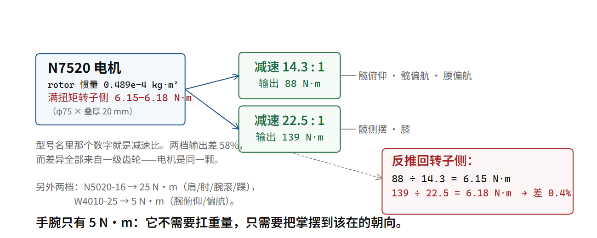

# 三代关节的账本：23.7 → 34.4 → 360 N·m

## 四颗电机，一条因果链

第 1 部讲了十章的物理。这一章只做一件事：拿宇树自己公布的器件，把那些式子逐个代一遍，并且把“代不出来的地方”标清楚。

| | GO-M8010-6 | IM6014（N6014B-12.6） | G1 膝（N7520-22.5） | H1 膝（M107 家族） |
|---|---|---|---|---|
| 峰值扭矩（输出） | 23.7 N·m | 34.4（反向）/ 31.7（同向）N·m | 139 N·m（官方配置限幅）／120（EDU 页）／90（基础页） | 360 N·m（页面）／300（官方 MJCF+URDF） |
| 减速比 | 1:6.33 | 3:38 = 12.667 | 22.5（型号名自带） | 未公布 [未] |
| 供电 | 12–30 V，推荐 24 V | 24–75 V | 未公布 [未] | 未公布 [未] |
| 峰值电流 | 40 A | 40 A | 未公布 [未] | 未公布 [未] |
| 扭矩常数 | 0.63895 N·m/A（输出端） | 未公布 [未] | 未公布 [未] | 未公布 [未] |
| 编码器 | 单圈绝对值 15 bit | 双绝对值 15 bit | 官方整机页只写“双编码器” | 同 |
| 总线 | RS-485 4 Mbps，17+16 B 帧 | RS-485 6/4 Mbps，20+26 B 帧 | 整机侧走 `rt/lowcmd`，官方口径 500 Hz | 同 |
| 标称频率 | 通信控制频率 6000 Hz | 最大总线轮询 10000 Hz | — | — |
| 质量 | 530 g | 535 g | 未公布 [未] | 官方“峰值扭矩密度 189 N·m/kg” [厂] |
| 单卖价 | $369 | 店铺标价存疑 | — | — |

来源：M8010 与 IM6014 全部 [厂]（产品页 + 文档中心协议页，可逐字核对）；G1 的 139 来自官方 `unitree_rl_lab` 配置，120/90 来自官方产品页；H1 的 360 来自产品页、300 来自官方 MJCF/URDF [厂]。

**这张表最该被读出来的，是它有多少格子写着“未公布”。** 一颗 2023 年就在卖的四合一关节，官方给了九个可核对的电气参数；而 2026 年装在旗舰人形上的那颗，只给了一个扭矩数。这不是宇树变保守了，是**产品定位变了**：M8010 是当元器件卖的（你要拿它自己搭东西，所以必须给全），G1/H1 的关节是当整机零件锁起来的（你不该单独用它）。

> [!QUOTE]
>
> 液压系统现在有几大问题：第一，成本非常高。另外，机械液压系统会漏油……
>
> 王兴兴 — 投中网（同上，来源 B），谈为什么选电驱不选液压 — 页面 2025-08-07；访谈本体约 2020 年前后（早年访谈转写）



## 第一笔账：那条 τ = k_t·i 到底准不准

第 04 章已经算过，这里复核并把误差说清：

```text
0.63895 N·m/A × 40 A = 25.56 N·m
官方峰值 = 23.7 N·m
差 +7.8%
```

7.8% 这个残差本身有意义。如果手册的 k_t 是纯几何量，它乘上手册的峰值电流应该**正好**等于手册的峰值扭矩。不等，说明中间有一刀被削掉了。可能是：

- 峰值电流 40 A 是瞬时允许值，而 23.7 N·m 是在某个更短脉冲宽度下的实测；
- 磁路在 40 A 时已经饱和，k_t 不再是常数（第 05 章的 τ = k_t·i 本来就是线性模型的产物）；
- 或者 23.7 是带效率折损的输出值，而 k_t 是理想换算值。

**官方没说是哪一种** [未]。本书能给的是判据：k_t 与 I 的乘积与标称扭矩差多少，差多少就说明这两项里至少有一项不是同一工况下的数。这一招对任何一颗电机手册都好用。

再往转子侧折一次：

```text
k_t(转子) = 0.63895 ÷ 6.33 = 0.10094 N·m/A
τ(转子) = 0.10094 × 40 = 4.04 N·m
× 6.33 = 25.6 N·m（理想）；按 85% 效率 = 21.7 N·m
```

（`foc_check.py kt_crosscheck()` 与 `quasi_direct_drive_torque()`。）

**4.04 N·m 的转子扭矩，装在 530 克、直径 96.5 mm 的壳子里。** 这个数才是“电机本身有多强”的度量，而 23.7 是“加了齿轮之后有多强”。整个第 14 章讲的取舍，就浓缩在这两个数之间。

## 第二笔账：官方数据自己完成了 τ = τ·N 的证明

第 14 章那条发现值得在这一章再摆一次，因为它是全书最干净的一条一手证据。

`unitree_rl_lab` 的 G1 配置里，关节电机型号名自带减速比 [厂]：

```text
N7520-14.3 → effort 88 N·m  → 88 ÷ 14.3 = 6.15 N·m（转子侧）
N7520-22.5 → effort 139 N·m → 139 ÷ 22.5 = 6.18 N·m（转子侧）
```

差 0.4%。同一台 φ75×20 电机，两个齿轮比，两档输出。

```text
N5020-16   → 25 N·m → 1.56 N·m（转子侧）
W4010-25   →  5 N·m → 0.20 N·m（转子侧）
```

于是 G1 的 23 个自由度其实只有四类器件，而扭矩档位是这么排的：

| 用在哪 | 型号 | 输出限幅 |
|---|---|---|
| 髋俯仰、髋偏航、腰偏航 | N7520-14.3 | 88 N·m |
| 髋侧摆、膝 | N7520-22.5 | 139 N·m |
| 肩×3、肘、腕滚、踝×2、腰侧倾/俯仰 | N5020-16 | 25 N·m |
| 腕俯仰、腕偏航 | W4010-25 | 5 N·m |

**看这张表就能读出这台机器的受力设计**：只有需要把身体撑起来、以及需要侧向抗住体重的三个位置（髋侧摆、膝）用了最高档；手腕只有 5 N·m——因为它不需要扛任何东西，它只需要把手掌摆到该在的角度。

这也解释了为什么 G1 的腕部是三个自由度里最弱的一档：**人形的手不是用来举重的，是用来定位的。** 而第 25 章会看到，一旦要“捏住东西不滑”，需要的就不是扭矩而是触觉。

## 第三笔账：扭矩密度与平方-立方

H1 官方页写着“峰值扭矩密度 189 N·m/kg” [厂]。用它反推关节单元质量：

```text
360 N·m ÷ 189 N·m/kg = 1.90 kg / 关节单元
```

而第三方拆解给的 G1 主承载关节约 1.1 kg [拆]。H1 的关节比 G1 的大 3 倍扭矩、重 1.7 倍——**方向对，量级对**。

再叠上第 02 章那条平方-立方：

```text
G1 → H2：线度 ×1.379
预测扭矩需求 ×L⁴ = 3.61；官方档位实际 ×3.0（120→360）～×4.0（90→360） ✓
预测质量   ×L³ = 2.62；官方实测 ×2.00（35→70 kg）  ← 比立方律省
```

（`foc_check.py torque_density_chain()`。）

**扭矩那一栏落在预测上，质量那一栏比预测省。** 这两件事同时成立才有意义：宇树的放大不是等比放大（否则 35 kg 的 2.62 倍应该是 91.7 kg），它在结构与材料上确实做了非等比优化；但**扭矩需求老老实实跟着 L⁴ 走，这一条谁也省不掉**，因为那是重力与几何的乘积，不是设计选择。

## 第四笔账：功率密度为什么不能当额定用

```text
M8010：23.7 N·m × 30 rad/s = 711 W ÷ 0.53 kg = 1.34 kW/kg
IM6014：31.7 N·m × 54.2 rad/s = 1718 W ÷ 0.535 kg = 3.21 kW/kg
```

这两个数是**两个角点的乘积**，而第 08 章已经证明那两个角点不可同时达到（M8010 在 30 rad/s 时反电势幅值 12.78 V，空载刚好在 24 V 母线的 SVPWM 上限 13.86 V 之内，但满载时铜损压降一加上就顶爆（14.38 V）；即使取官方上限 30 V 母线，17.32 V 仍然不够）。

所以 1.34 kW/kg 是**名义上界，不是可运行点**。真正可运行的那条曲线，是从 (30 rad/s, 0 N·m) 到 (0 rad/s, 23.7 N·m) 之间那条被母线电压弯下去的弧，而弧的具体形状需要 L、R、k_t(T) 三个数——**官方一个都没给** [未]。

这是本书能给工程师读者的最有用的提醒之一：**任何一体化关节的参数表，都不足以让你算出它的热设计。** 你能算出它的上限形状，算不出它能在上限的百分之多少持续工作。而“持续”两个字，恰恰是人形机器人真正的瓶颈（第 36 章）。

## 三代之间到底变了什么

把四列横着看，演进的方向非常清楚：

**一，电压往上走。** 24 V 推荐 → 24–75 V。第 08 章说过，提电压买的是转速上限不是扭矩。IM6014 官方把 54.2 rad/s 明确标在 60 V 下 [厂]，就是在把那个“不可达的角点”变成可达。

**二，减速比往上走，但只走一半。** 6.33 → 12.667 → 14.3/22.5。注意这条链**没有走向谐波的 60–160**。Z1 是宇树唯一明说用谐波的产品（60+、背隙 6 弧分）[厂]，而它是机械臂不是人形。**在人形上，宇树停在 25 以下。** 第 14 章解释了为什么：低减速比才能让 `tau_est` 成立，才能不用每关节一颗力矩传感器。

**三，从单圈到双编码器。** M8010 单圈绝对值，IM6014 双绝对值 [厂]。多出来的那颗输出端编码器，是为了让控制器第一次能知道传动链在不在撒谎。

**四，开始监控温度。** IM6014 官方标“每秒 400 次温度监控” [厂]，`MotorState` 里带 `temperature int16[2]` [厂]。第 05 章那条“k_t 随温度漂”、第 36 章整章的降额问题，在这里已经有了硬件入口——**厂商开始报温度，说明他们知道额定值必须由温度决定。**

**五，能给的数越来越少。** 从九项电气参数到一项扭矩。这一条不是技术演进，是商业策略，但它直接决定了这本书能写多具体。

## 还有一个没被选中的答案：丝杠

上面三笔账都在算“旋转电机 + 减速器”这一条路。但把电机换成直线电机、把减速器换成滚珠丝杠，
是一条真实存在过的替代方案——工业升降台、注塑机、大多数灵巧手的指节都在用它。
人形关节为什么没选？三个理由，每一个都能算。

**第一个理由：丝杠给的是直线，关节要的是转角。**
丝杠的力学关系极其干净：导程 L（螺母转一圈走多远）决定一切。
忽略摩擦时 τ = F·L ÷ 2π，反过来 1 牛米能顶起 F = 2π·η ÷ L 的推力。
取导程 8 mm、中径 20 mm、效率 0.93（滚珠）的丝杠：

```text
1 × 6.283 × 0.93 ÷ 0.008 = 730 N
```

也就是说 1 牛米的电机扭矩能顶 730 牛的直线推力——比任何旋转减速器都便宜地拿到大力。
这正是它被工业界选中的原因。但要把这 730 牛变成“膝盖弯 40°”，得再加一组连杆或弧面滑槽，
于是瞬时传动比变成角度的函数：同一个 1 牛米，在屈膝 30° 和 90° 时给出的关节扭矩不一样。
第 05 章那个 sinθ 的麻烦，以另一种形式回来了——而且这次连 k_t 这个常数都不是了。

**第二个理由：摩擦角与自锁。**
螺旋升角 λ 由几何决定：导程除以中径的周长。上面那根丝杠 λ = 7.3°。
摩擦能不能咬住它，看摩擦角 φ = arctan μ。梯形螺纹加润滑脂，μ 取 0.15（行业典型值 0.1–0.2 [行]），
φ = 8.5°。因为 λ < φ，这根丝杠**自锁**：断电后负载压不回来，螺母不会自己转。
工厂里这是优点（省一套抱闸，断电即安全）。对一条腿这是致命的——
第 12 章讲阻抗控制时说得很清楚：脚落地那一下，关节必须能被反着推。
自锁的传动链等于把关节焊死，冲击全部由齿轮、轴承和结构件硬接。
滚珠丝杠把 μ 压到 0.005–0.01，φ 只有 0.3°–0.6°，远小于 λ，所以不自锁、可以反驱——
但它的效率优势（同样那组数算出 η ≈ 0.93，梯形丝杠只有 η ≈ 0.45）是拿“必须加防逆转”换来的。

**第三个理由：摩擦迟滞就是齿隙的亲戚。**
第 14 章量过那颗 15 bit 编码器与 0.1° 齿隙的差距（187 倍）。螺纹副里的间隙、
滚珠循环回路的弹性变形、以及换向时静摩擦到动摩擦的跳变，合起来是同一类东西：
**输入端动了，输出端先不动**。力控环在 1 kHz 上工作，遇到这种死区就会自激。
旋转减速器里我们管它叫齿隙；丝杠里它还在，而且因为要额外克服摩擦才启动，更难补偿。

**那它到底该用在哪。** 三个条件同时满足时丝杠完胜：行程是直线的、需要极大的力、
而且“断电即停”本身就是安全要求。升降平台、灵巧手指节（空间小到塞不下减速器，
而且自锁省掉持续保持电流）、机床 Z 轴，都是这一格。
人形机器人身上真要找这一格的地方，是它的**手**，不是它的腿。
（宇树灵巧手内部是否用丝杠传动，未公布 [未]。上面全部数值是教科书级的机构算例 [行]，
不是对任何一款宇树产品的描述。）

## 类比，以及它在哪儿破

类比：这四颗电机像一家车厂的发动机谱系——同一套工艺，靠缸径、行程、变速箱的组合铺出不同档位。7520/5020/4010 是缸径与行程，14.3/22.5/16/25 是变速箱速比，effort 限幅是厂标扭矩。

**这个类比在哪里破**：汽车发动机有明确的额定工作点（额定功率、额定扭矩、外特性曲线），因为车要过排放与耐久认证，法规逼着厂商公布。机器人关节**没有任何一条法规要求厂商公布额定扭矩**。所以类比里那半句“厂标额定值”，在这里根本不存在——不是厂商藏着不给，是这个行业还没有强制给。这是第 37 章（安全与认证）会接上的一个缺口。

---

**一个可检验的说法**：宇树四代关节器件的官方可核对参数数量从 M8010 的九项电气参数降到整机关节的一项扭矩；G1 的 23 个自由度实际只用四类电机（N7520-14.3 / N7520-22.5 / N5020-16 / W4010-25），其中只有髋侧摆与膝用最高档 139 N·m，腕俯仰与腕偏航只有 5 N·m；而 88÷14.3 = 6.15 与 139÷22.5 = 6.18 相差 0.4%，构成 τ(输出) = τ(转子) × N 的官方自证。

**证据等级**：M8010 / IM6014 全部参数 [厂]；G1 四类电机型号与 effort 限幅 [厂]（`unitree_rl_lab` 配置）；G1 膝 90/120/139 三个数分别来自基础版页面、EDU 页面与模型文件，**本书并列不合并**；H1 360（页面）与 300（MJCF/URDF）同理并列；1.90 kg、3.61、2.62、1.34 kW/kg、12.78 V 全部 [算]；20.58 速比与 1.1 kg 是 [拆]，与官方型号名里的 22.5 冲突，两条都留。

**可核对清单**：

- [ ] 跑 `foc_check.py` 的“15 G1 减速比一致性”与“15 扭矩密度与平方立方”两条
- [ ] 打开 `unitree_rl_lab` 的 G1 配置，找到 N7520-14.3 / N7520-22.5 / N5020-16 / W4010-25 四个键名，抄下 effort_limit 与关节分组
- [ ] 在 G1 产品页、G1 EDU 页、官方模型文件三处分别记下一个膝关节扭矩数，确认它们是否相同
- [ ] 数一遍 M8010 页面给了几项电气参数、G1 页面给了几项，感受那条“越来越少”的曲线

**下一章**：第 1 部到此结束——你已经知道一颗关节从磁场到螺丝的一切，也知道哪些数永远拿不到。第 2 部开始往上建：23 个这样的关节，怎么让一台 35 公斤的两足物体不摔。第一个答案是一句算术：四个支点可以零力矩，两个不行。
