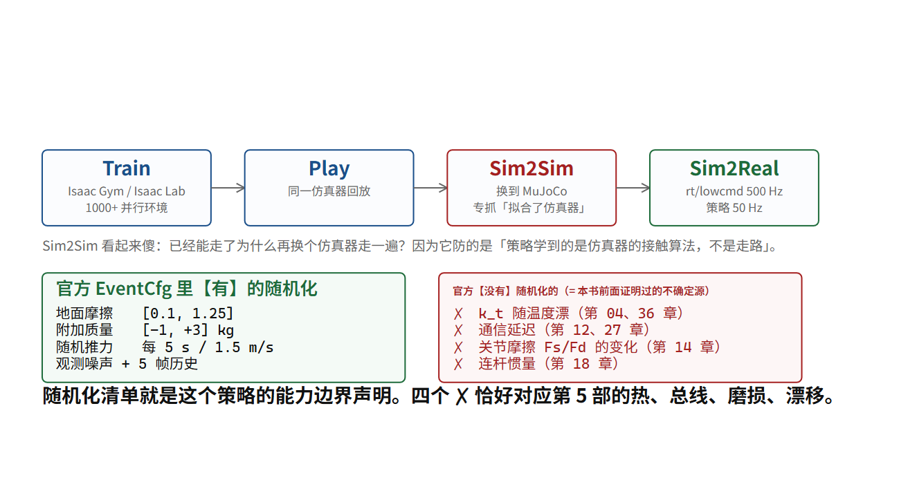

# 强化学习运控：宇树公开的这条工序

## 为什么现在的人形用神经网络走路

第 19 章给出了答案的一半：接触模式是组合爆炸，显式优化算不起。另一半是：**就算你算得起，你也建不准。**

一台真实人形的模型里，你需要知道的质量、惯量、摩擦系数、电机扭矩常数、减速器效率、脚底材料刚度——**第 1 部已经数过一遍，宇树连其中一半都没公布** [未]。而你只需要一个参数错得稍微多一点，1 kHz 的高增益控制器就会开始抖（第 18 章的 ω_n 撞带宽）。

强化学习的解法非常工程师：**别猜这些参数了，把它们当成随机数，在一大片参数云里训练一个对参数不敏感的策略。**

这一章讲宇树公开的这条工序，以及每一步在防哪一种失效。

> [!QUOTE]
>
> 如果要进一步机器人能力提升，也就是机器人 RL 的 Scaling Law，还是做得非常不好。……我训练一个机器人做新的动作、跳新的舞蹈，都要重新训练，还是从头开始训练，这是非常不好的一个事情。……因为 RL Scaling Law 在语言模型上已经是充分验证过的事情。但在机器人的运动控制上面，大家才刚刚开始。
>
> 王兴兴 — 王兴兴 2025 世界机器人大会主旨演讲（新浪“机器人前瞻”文字实录） — 2025-08-09（第一人称演讲逐字）



## 官方公开的四个步骤

宇树在 `unitree_rl_gym` 与 `unitree_rl_lab` 两个仓库里把工序写成四步 [厂]：

```
Train      在 Isaac Gym / Isaac Lab 里并行上千个环境，用 PPO 训练
Play       在同一个仿真器里回放，看策略行不行
Sim2Sim    把训好的策略搬到 MuJoCo（unitree_mujoco）里再跑一遍
Sim2Real   导出到真机，跑在 rt/lowcmd 上
```

**注意第三步 Sim2Sim 是整条工序里最值得学的一步，而且它看起来很傻。** 你在 Isaac 里已经能走了，为什么还要换一个仿真器再走一遍？

因为它防的是**“过拟合到仿真器”**。

两个仿真器的接触求解器、积分器、碰撞几何处理都不一样。一个策略如果只在 Isaac 的接触模型下能走，它其实学到的是“Isaac 的物理怎么算”，不是“怎么走路”。搬到 MuJoCo 就摔——**而这在真机上一定会发生，只是 MuJoCo 让你提前两周知道。**

这是本书想给读者的一个可迁移的方法论：**任何“在 A 环境训好、要在 B 环境跑”的系统，都应该有一个 A→A′ 的中间检查，其中 A′ 是与 A 同类但实现独立的另一套。** 它便宜、可重复、而且专门抓那一类“看起来对其实只是拟合了模拟器”的错误。

（同样的道理适用于单元测试：一个只测到自己 mock 行为的测试，等价于一个只在 Isaac 里能走的策略。）

## 仿真器版图：Sim2Sim 要跨的是“哪一族”

上一节说 Sim2Sim 防的是“过拟合到仿真器”，而它成立的前提是**两个仿真器的接触求解真的不一样**。这句话太轻了——工程师需要的是能查的地图。下面这张表就是那张地图：每个仿真器的接触靠什么算、能不能大规模并行、并行的代价是什么、以及**它会把你这条工序筛掉哪一类策略**。

**表里每一个数都回到官方页面/论文核对过，抓取日期 2026-10-08**（来源列写的是可粘贴的 URL）；核不到的格子按本书规矩**留空并标 [未]**，本书不用二手口径填它。

| 仿真器 | 接触求解方式 | 能否大规模并行 | 并行的代价 | 这个选择会筛掉哪一类策略 | 来源（抓取 2026-10-08） |
|---|---|---|---|---|---|
| **Isaac Sim 6.1 + Isaac Lab** | PhysX 5 的**迭代投影**求解器：`solver_type` 可选 0 = PGS（Projective Gauss-Seidel）或 1 = TGS（Temporal Gauss-Seidel），**Isaac Lab 把默认设成 1（TGS），而 PhysX SDK 自己的 `PxSceneDesc` 默认是 `ePGS`——两个层级各有各的默认，别把它们当成同一个数**；迭代次数被夹在 min/max position/velocity iteration 之间 | 能，GPU 加速默认开启 | **GPU 管线的缓冲不能动态增长**：`gpu_max_rigid_contact_count` 等 `gpu_*` 参数必须预先估够，“insufficient buffer sizes → 仿真报错并出现异常行为”（Isaac Lab 原文） | 依赖“约束求解顺序”的策略：PhysX 有一个 `solve_articulation_contact_last` 开关，默认关闭，原文说“严格的约束顺序对抓取场景未必理想”——**开关一换，同一份权重的接触力分配就变了** | https://raw.githubusercontent.com/isaac-sim/IsaacLab/main/source/isaaclab/isaaclab/sim/simulation_cfg.py（`PhysxCfg` 的文档字符串，逐字核对）；https://nvidia-omniverse.github.io/PhysX/physx/5.4.1/_api_build/classPxSceneDesc.html（`solverType` 默认 `ePGS`）；https://docs.isaacsim.omniverse.nvidia.com/latest/（目录首条 = Isaac Sim 6.1） |
| **MuJoCo 3.15.0（CPU）** | **软接触 + 凸优化**：官方文档明确“we drop the strict complementarity constraint at the heart of the LCP formulation”，接触力定义为凸优化问题的唯一全局解（棱锥摩擦锥 → QP，椭圆摩擦锥 → conic program），默认求解器 Newton（PGS 曾是默认，文档称“自我们做出 Newton 之后它在各方面都更好”） | 本体是 CPU 实现；官方给的并行路径就是下一行的 MJX | 单场景已经够快（官方实测见下一行第一个数 650K steps/s），但要并行必须换实现 | 学到“穿透深度 = 力”这一本构的策略：软接触允许穿透并把它换成刚度×穿透，**换成严格非穿透的求解器时这条曲线不存在** | https://mujoco.readthedocs.io/en/stable/computation/ ；版本取自 PyPI `mujoco` 3.15.0（2026-10-05） |
| **MJX（MuJoCo on GPU/TPU）** | 同一套软接触凸优化，重新实现为 JAX/Warp 内核；MJX-Warp 专攻 NVIDIA GPU | 能：官方基准用 batch 8192（A100）与 16384（8 芯片 v5 TPU） | 官方给的四个吞吐数（单个 humanoid 场景）：M3 Max **650K**、64 核 AMD 3995WX **1.8M**、A100/MJX-JAX **950K**、TPU **2.7M** steps/s；**单场景时 MJX-JAX 可以比 CPU MuJoCo 慢 10 倍**；随 humanoid 数量增加，MJX-JAX 吞吐下降比 MuJoCo 快；凸网格顶点数建议 ≤200（网格-基元）/ <32（凸-凸） | 把“接触对数量”当常数用的策略：MJX-JAX 的 broad-phase 是无分支的简化版，**多接触堆叠场景（灵巧手、脚底多点接触）下它掉得最快** | https://mujoco.readthedocs.io/en/stable/mjx.html （含上述实测口径） |
| **SAPIEN 3.0.3 / ManiSkill3** | 底座是 **PhysX**：核到的官方一手证据是 ManiSkill 文档的源码页里那一行 **`import sapien.physx as physx`**，类型名 `physx.PhysxArticulationJoint`、`physx.PhysxArticulation` 直接暴露了引擎族（ManiSkill README 本身不出现 PhysX 字样）——即与 Isaac 同族的迭代求解器；并行侧 SAPIEN 文档首页另有一句自己的口径 “Physical simulation on CPU and GPU, reaching 100,000+ FPS for simple robotics tasks.” | 能，官方主打：GPU 并行仿真 + GPU 并行**异构**仿真（页原文 “GPU parallelized heterogeneous simulation, where every parallel environment has a completely different scene/set of objects”） | 官方 README 与论文给的两个数**都不是物理步进口径**：README 的 “collect RGBD + Segmentation data at **30,000+ FPS** on a 4090 GPU” 是**视觉数据采集**速率；论文（arXiv:2410.00425，v2，最后修订 2025-05-30，RSS 2025）的 “run **10-1000x** faster with 2-3x less GPU memory usage than other platforms” 是**带渲染**的整平台比较。“real2sim”那一格核到了原文：**“Real2sim environments for scalably evaluating real-world policies 100x faster via GPU simulation.”**（README）——**它说的是“用 GPU 仿真批量评估真机策略”比另一条路快 100×，不是物理保真度、也不是步进吞吐**；蓝图把它读作“real2sim 快约 100×”是口径滑移，本书按原文改写 | **本书特意提醒**：把 30,000+ FPS 当物理步进口径来设计算余量，会算错一整档；这一族与 Isaac 同为迭代投影，所以**“ManiSkill 训、Isaac 复核”不构成 Sim2Sim**（同族），要跨族得跳到 MuJoCo/Genesis 那一列 | https://raw.githubusercontent.com/haosulab/ManiSkill/main/README.md ；https://maniskill.readthedocs.io/en/latest/_modules/mani_skill/utils/structs/articulation_joint.html （physx 那一行）；https://sapien-sim.github.io/docs/ （“100,000+ FPS” 与 “10,000+ images every second” 两句）；https://arxiv.org/abs/2410.00425 （v2，2025-05-30）；PyPI `sapien` 3.0.3（页面显示发布 2026-03-10） |
| **Genesis（Genesis World）1.4.3** | **软接触（惩罚式）**：官方文档 “the solver gathers every constraint into one system and solves it once per step”、**“The penalty is finite, so constraints are never enforced exactly.”**；摩擦锥默认棱锥（页原文 “a point becomes four rows approximating the Coulomb friction cone by a pyramid”），**“The elliptic cone is unsupported with differentiable simulation.”** | 能：官方文档 “Genesis World supports tens of thousands of environments on a single GPU”；README 列出的求解器族是 “Rigid, FEM, MPM, Particle (PBD / SPH), uipc, an explicit coupler, and SAP”（多物理在同一 scene，靠耦合器拼起来） | 官方文档 “memory use grows with the batch, so reduce it if your GPU runs out of VRAM”——**显存是第一个墙**；**蓝图与前一版都提过的“相对 Isaac/MJX 快 10–80×”这一类倍数，本轮回读官方 README 与文档未找到任何此类数字 ⇒ 该行按“未核到”处理** [未] | **可微是把双刃剑**：官方明确有些接触/碰撞路径没有梯度（“gradients through them may be zero or undefined”），需要梯度时刚体走 GJK 碰撞路径（“The rigid solver uses the GJK collision path when gradients are required”）——**靠解析梯度穿过接触训练的策略，它的梯度本身就依赖你选了哪条碰撞路径** | https://raw.githubusercontent.com/Genesis-Embodied-AI/Genesis/main/README.md ；genesis-world.readthedocs.io 的 en/latest 文档：user_guide/theory/rigid_solver/constraints、user_guide/theory/differentiable_simulation、并行仿真一节；PyPI `genesis-world` 1.4.3（页面显示发布 2026-09-30） |
| **Newton 1.0.0（文档 latest = 1.7.0.dev0）** | **多求解器并存**，接触方式跟着求解器走：官方文档 “SolverMuJoCo wraps mujoco_warp behind Newton's standard solver interface.”（即软接触凸优化那一族），另有 SolverFeatherstone（与 MuJoCo 同为广义坐标）、SolverXPBD / SolverSemiImplicit / SolverKamino（ maximal 坐标，Kamino 页面标 experimental）、SolverVBD（布/软体/刚体统一，experimental）；碰撞侧文档给 “precomputes a signed distance field that provides O(1) distance lookups”、height field “stores a regular 2D grid of elevation samples”，以及 hydroelastic 的“分布式面接触”表述 | 能：GPU 加速、基于 NVIDIA Warp；由 Disney Research、Google DeepMind 与 NVIDIA 发起，README 明写 “integrates MuJoCo Warp as its primary backend” | 官方文档对可微性留了明确的口子：collisions 页原文 **“Rigid-contact differentiability may change without prior notice.”**，solvers 索引页另有 “public API and behavior may change without prior notice” ⇒ **刚体接触这一路的可微性今天还不能当稳定接口用**；且 Newton 自己把“窄相位 + 端到端可微”列为仍在推进的能力 | 最要紧的一条：**它同时能装两种互相矛盾的接触模型**（MuJoCo 后端 = 软接触，Kamino = 官方描述里带 “hard frictional contacts” 的约束机构求解器）——所以“我训练和复核都用 Newton”这句话没有信息量，除非你说清是哪个 solver | https://raw.githubusercontent.com/newton-physics/newton/main/README.md ；newton-physics.github.io/newton/latest 的 solvers/index、solvers/mujoco、concepts/collisions 三页；PyPI `newton-physics` 1.0.0（页面显示发布 2026-02-27） |

**这张表怎么用：判据是“跨族”，不是“跨软件”。**

为什么？把每一格按接触的本构归一次类就清楚了：

```
软接触（允许穿透，力 = 刚度 × 穿透）：MuJoCo / MJX / Genesis / Newton 的 MuJoCo 后端
迭代投影（先给非穿透约束，再用有限次 Gauss-Seidel 逼近）：PhysX（Isaac、SAPIEN/ManiSkill3）
硬接触互补（LCP 族，严格互补性）：MuJoCo 文档明确说他们放弃了这一族
可微：Genesis（部分路径）、Newton（刚体接触为实验性）
```

于是“Isaac → MuJoCo”是跨族（迭代投影 → 软接触），而“MuJoCo CPU → MJX”是同族不同实现——后者只能抓积分器、管线、内存布局那一类 bug，**抓不到接触模型本身带来的差异**。宇树那条工序（Isaac 训练、`unitree_mujoco` 复核）恰好是跨族的，这一层它选对了。

**再来一次追问：为什么“同族”就抓不到？** 因为要抓的错误长在“脚底什么时候算接触上、接触力等于什么的函数”这一层。软接触给了策略一条连续可导的力-穿透曲线，策略可以大胆用“陷进去一点再蹬”；迭代投影给的是一条被有限次迭代近似出来的阶跃，而且它的接触点本来就带间距生成——PhysX 的 `PxSceneDesc` 原文是 “If the separation distance of a contact point is greater than the threshold then the contact point will not experience friction forces”，**意思是接触点可以在两个几何面真正相交之前就已经存在，只是超过阈值就不给摩擦力** [查]。同一份权重在两种“接触开始时刻”下，脚底相位的判定就不一样——而第 22 章会说，这类差异调参无解。

**并行的代价这一栏为什么重要？** 它决定你能不能把“多跑几个仿真器交叉验证”这件事放进训练计划。用官方那两个数做一次除法，量级就出来了：

```
A100 上 950,000 steps/s ÷ 8192 envs ≈ 116 steps/s / env
TPU 上 2,700,000 steps/s ÷ 16384 envs ≈ 165 steps/s / env
```

（[算]，两个被除数与 batch 都取自 MuJoCo 官方文档 [查]。）对比本章开头那三个数：`sim.dt = 0.005 s` 是 200 Hz 物理积分、策略 50 Hz。**116 与 165 都低于 200 Hz**——也就是说单个并行环境跑不到实时，“实时率”要靠 batch 里的环境总数换：

```
950,000 steps/s ÷ 4 = 237,500 次策略推理/秒   （decimation = 4 ⇒ 每 4 个物理步一次策略输出）
```

（[算]。）反过来，CPU 上单场景 MuJoCo 的 650K steps/s ÷ 200 Hz = **3250 倍实时** [算]（同一份官方数）。**并行不是让一次仿真变快，是让“跑很多遍”变便宜**——而 Sim2Sim 恰好就是“跑很多遍”这件事，所以它便宜、可重复、值得学。

**这条链的断点**：官方吞吐数是在特定场景（1 个 humanoid、特定 batch、特定硬件）上测的，且 MuJoCo 文档自己写了“humanoid 数量增加时 MJX-JAX 吞吐下降得比 MuJoCo 快” [查]。**换句话说，你把它换成你自己的多接触场景，这两个数就不成立**——这张表给的是族别与量级，不是你项目的预算表。至于宇树用哪个仿真器版本、有没有并行、训练用了多少环境，官方未公布 [未]；`unitree_rl_lab` 的 pin 版本另见本章版本陷阱一节。

## 版本陷阱：这条工序正在换代

这是必须写进书里的一条实操事实，因为它会浪费读者一整天：

| 仓库 | 依赖 | 状态 |
|---|---|---|
| `unitree_rl_gym` | **Isaac Gym Preview 4** + PyTorch → TorchScript 策略 → `rt/lowcmd` | Isaac Gym 是预览版，NVIDIA 已于 2025-07 前后终止支持 [厂][查] |
| `unitree_rl_lab` | Isaac Sim 5.1 + Isaac Lab 2.3 + rsl_rl | 当前官方推荐路线 [厂] |

**两代不通用**：环境接口、配置格式、动作缩放约定都不同。你在网上找到的绝大多数教程与复现，是 Gym 那一代的。

（具体版本号取自两个仓库 README 的自陈 [厂]；行业侧当前主线已到 Isaac Sim 6.1 + Isaac Lab 3.0 beta [查]，宇树仓库的 pin 版本会落后于上游，这是正常的。）

**上一句里的“Isaac Lab 3.0 beta”这一档，本书回到官方核过，结果是三条并存，本书并列不裁决（均于 2026-10-08 抓取）** [查]：

```
Isaac Sim 文档站 latest        → 目录首条是 Isaac Sim 6.1（4.5 / 6.0 是旧版与迁移指南）
Isaac Lab 仓库 main 的 VERSION → 2.3.2
Isaac Lab GitHub Releases 最新 → v3.0.0-EA（往前依次是 v3.0.0-beta2.patch1、v3.0.0-beta2）
PyPI 上的 isaaclab             → 2.3.2.post1
```

**这四条不完全对齐**：仓库里钉的是 2.3.2，发布列表已挂到 3.0.0-EA，而 PyPI 只发到 2.3.2.post1。**读法只有一条：`EA` 是 Early Access，它不是可 `pip install` 的稳定通道。** 所以“行业主线是 3.0”这类句子得说清是按发布标签读还是按 PyPI 读——两个口径差着一个可安装版本。

同一批核对里另两条要登记：`genesis-world` 在 PyPI 的当前版本是 **1.4.3**（2026-09-30 上传），蓝图写的 1.4.2 是它的前一版；`mujoco` / `mujoco-mjx` 在 PyPI 是 **3.15.0**（2026-10-05）；而“SAPIEN/ManiSkill 的 real2sim 快约 100×”这一条本书**没能回到任何官方页面核到**，因此不进正文、只登记为未核 [未]。

## 一次训练里，控制环是怎么摆的

从官方配置能读出这台机器的时间结构（`unitree_rl_lab` 的 G1 配置 [厂]）：

```
仿真步长 sim.dt        = 0.005 s        （200 Hz 物理积分）
动作重复 decimation    = 4
⇒ 策略输出频率          = 200 / 4 = 50 Hz
动作缩放 action_scale   = 0.25（按关节不同，配置里逐关节给）
```

这三行值得逐个解释，因为它们是“策略到底在控制什么”的确切答案。

**一，策略以 50 Hz 输出。** 不是 1 kHz。第 12 章那条级联链里，策略站在“位置/速度给定”那一层，它的下面还有 500 Hz 的话题层和 kHz 量级的关节环路。**策略不需要快，因为它不处理平衡的毫秒级细节——那些由关节里的 kp/kd 兜住。**

**二，`decimation = 4` 意味着一个动作被重复执行 4 个物理步。** 也就是说策略说一次“目标角度是多少”，之后 20 毫秒里不再改变。这是一个显式的**零阶保持**，它同时起到两个作用：降低策略需要输出的频率，以及强迫策略不能依赖超高频反馈（否则它在真机上会因为延迟不同而失效）。

**三，`action_scale = 0.25` 是最容易被误读的一项。** 策略输出的不是关节角，而是一个“增量”，乘上 0.25（再乘上该关节的动作范围）才变成目标位置。所以：

```
q_target = q_nominal + action × scale × (上限 − 下限) × 0.5 之类
```

（具体形式各仓库不同，本书不写死 [厂]。）

**这条缩放的意义**：策略学的是“相对当前该动多少”，而不是“绝对到哪”。这让策略更容易迁移（不同初始姿态都能用），也让动作幅度天然受限。**如果你复现时把 action_scale 改了，你实际上改的是策略的输出分布——训练好的权重会立刻失效。** 这是新手最常踩的一个坑。

## 域随机化：随机的是哪些数

这是整条工序里技术含量最高、也最被低估的一步。它的形式非常朴素：每个 episode 开始时，把一批物理参数重新随机抽样。

**先把官方到底随机化了什么抄准。** 本书第一版这一段写错了——写成了「教科书上的域随机化清单」，而不是仓库里的清单。逐文件核对 `unitree_rl_lab` 的 `velocity_env_cfg.py` 之后，事实是这样：

```
EventCfg 里实际有的：
  地面摩擦系数   区间 [0.1, 1.25]
  附加质量       区间 [−1, +3] kg
  随机推力       每 5 秒一次、幅值 1.5 m/s
  观测噪声       + 5 帧历史

EventCfg 里没有对应条目的：
  执行器增益 / 扭矩误差、连杆惯量、摩擦模型参数 Fs/Fd、
  通信延迟、地面弹性参数、电机温度模型
```

（[厂]，逐文件核对。）

**这个清单比教科书清单短得多，而这一点本身就是信息。** 它说明宇树公开的这条 sim2real 工序，赌的是「质量 + 摩擦 + 外力 + 观测噪声」四类不确定性，而把第 04 章的 k_t 温漂、第 13 章的延迟、第 36 章的温度模型**留在了未覆盖区**。

于是「随机化清单就是能力边界声明」这条判据，现在可以给一个真实的读法：

| 本书前面证明过的不确定源 | 官方清单里有吗 | 若没有，意味着什么 |
|---|---|---|
| 负载与质量变化 | ✅ [−1, +3] kg | 背个工具箱，训练时见过 |
| 地面摩擦 | ✅ [0.1, 1.25] | 湿滑地面部分覆盖 |
| 被推 | ✅ 每 5 s / 1.5 m/s | 有 |
| 观测噪声 | ✅ | 传感器精度问题有 |
| **k_t 随温度漂**（第 04、36 章） | ❌ | **热态与冷态不是同一台机器，策略没见过** |
| **通信延迟**（第 12、27 章） | ❌ | 总线拥塞时的行为未训过 |
| **关节摩擦 Fs/Fd**（第 14 章） | ❌（模型里有摩擦，但不随机化） | 摩擦随磨损变化未覆盖 |
| **连杆惯量**（第 18 章） | ❌ | 末端附加质量之外的惯量变化未覆盖 |

**这张表不是批评。** 没有人能随机化所有东西，每一项随机化都有算力与训练代价，而且随机化太多会让策略保守到不敢用力。**它是你在部署前该自己补的那张清单**——上面四个 ❌，恰好对应第 36 章的热、第 27 章的总线、第 38 章的硬件漂移，也就是第 5 部整部在讲的四件事。

## 特权信息与蒸馏：一个已用上的，一个没启用

训练时你可以给策略看一堆真机上不存在的东西：机体线速度、无噪声的姿态、未来若干步的地形。这些叫**特权信息（privileged observations）**。

**宇树两个仓库的实际情况，本书逐文件核对后如下（这一条第一版也写重了，必须写实）：**

```
特权信息的实际用法：非对称 actor-critic ——
   critic 额外看 base_lin_vel（机体线速度），观测维度 47 → 50；
   actor 不看。这是「训练时用特权、执行时不用」的最轻量形式。

蒸馏：unitree_rl_gym 全仓库 0 处命中；
      unitree_rl_lab 里有 DistillationRunner 的代码钩子，
      但没有任何一个配置使用它，train.py 只构造 OnPolicyRunner。
```

（[厂]。）

**所以准确的说法是：宇树公开仓库里有蒸馏的接口，没有蒸馏的用法。** 教科书里那条「特权教师 → 板载学生」的完整工序，在这两个仓库里没有被走通。

而非对称 critic 那一招是**真的用上了**，而且用得其所：真机上机体线速度确实拿不到（没有足端力传感、没有外部定位，第 14、24 章），所以「让 critic 看一眼、actor 不看」正好补上这个缺口。**这是一个很小的特权技巧，不是一个尚未启用的大架构。** 分辨这两者，是读开源训练仓库比读论文摘要能多得到的东西。

（某一款出厂固件内部是否另训了蒸馏学生，官方未公布 [未]。）

## 一个能救你一天的工程陷阱

核对配置时本书撞到一个足以让人怀疑人生的细节，值得印进书里 [厂]：

在 `deploy/robots/g1_29dof/.../deploy.yaml` 里，`stiffness` 与 `damping` 两列**按 SDK 电机序号排列**，而 `default_joint_pos`、`actions.*.scale`、`actions.*.offset` 三列**按 Isaac Lab 的仿真关节序排列**。两套顺序靠一个 `joint_ids_map` 桥接：

```
joint_ids_map = [0, 6, 12, 1, 7, 13, 2, 8, 14, 3, 9, 15, 22, 4, 10, 16,
                 23, 5, 11, 17, 24, 18, 25, 19, 26, 20, 27, 21, 28]
```

**把 deploy.yaml 当成同一个索引序读，就会全部错位**——每个关节拿到别人的刚度、别人的零位。而这类 bug 的表现是「机器能动，但动作很怪」，最难查。

同一个仓库里还有第二处不一致：`deploy.yaml` 给腰部 stiffness 200、手臂 damping 10，而 `unitree.py` 里同一批参数是 40 与 1 [厂]。**两处都是官方文件，本书并列，不裁决。**

**而 action_scale 不是拍脑袋的数。** 官方 mimic 配置里逐关节的 scale 是 0.548 / 0.351 / 0.439 / 0.0745，本书按官方 T-N 参数逐位验算：

```
0.25 × 88 ÷ 40.179 = 0.548   （hip_pitch / hip_yaw / waist_yaw，N7520-14.3）
0.25 × 139 ÷ 99.098 = 0.351  （hip_roll / knee，N7520-22.5）
0.25 × 50 ÷ 28.501  = 0.439  （ankle、waist_roll/pitch）
0.25 × 25 ÷ 14.251  = 0.439  （肩、肘、腕 roll）
0.25 × 5 ÷ 16.778   = 0.0745 （腕 pitch / yaw，W4010-25）
```

（[算]，输入 [厂]。）**每个 scale 都等于「0.25 × 该关节的扭矩限幅 ÷ 该关节的位置刚度 kp」**。量纲一算就通：N·m ÷ (N·m/rad) = rad，所以这个数就是“一个单位归一化动作等于多少弧度”，0.25 再把它压到量程的四分之一——也就是把归一化的动作按关节的量程重新标定。而速度类任务用的是另一套手调 PD（100/150/200/40），mimic 类用的是按 10 Hz 固有频率反推的物理值（40.18 / 99.10 / 14.25 / 16.78）[厂]。

**这一条正好是第 18 章那道「ω_n = √(kp/J)」天花板的官方实例**：给定固有频率 10 Hz 与官方 armature，就能算出 kp——官方就是这么算的。

## 类比，以及它在哪儿破

类比：域随机化像飞行员在模拟器里被要求在各种坏天气、坏引擎状态下起飞，这样真遇到侧风他不会第一次学。

**这个类比在哪里破，而且破在关键处**：人类飞行员在模拟器里学到的东西可以直接迁移，因为**模拟器的物理是真的**（空气就是那些方程）。而仿真的接触动力学**不是真的**——它的求解器是近似，摩擦锥是多面体近似，碰撞体是凸包近似。

所以域随机化不是“让仿真变准”，而是**“让仿真准不准变得不重要”**。它是一个策略：如果我把沟填不平，那我就把沟的宽度随机化，让被训练者学会在任意宽度的沟上都能过。

**代价也很明确：一个在参数云里存活的策略，通常比一个针对精确模型调出来的策略性能差。** 它放弃了最优，换来了“模型不准也能用”。这就是足式运控这十年做的交易。

---

**一个可检验的说法**：宇树公开的运控工序是 Train → Play → Sim2Sim → Sim2Real，其中 Sim2Sim（Isaac 训练、MuJoCo 复核）的作用是专门捕获“过拟合到单一仿真器的接触模型”这一类错误；策略以 50 Hz 输出（sim.dt 0.005 × decimation 4），其下的毫秒级细节由关节内的 kp/kd 环路兜住；域随机化的参数清单（质量、惯量、摩擦、k_t、观测延迟、零位偏移、外力）恰好对应本书第 1 部与第 2 部列出的那些“厂商未公布或物理上会漂”的量，因此**随机化清单可以直接当作一个策略的能力边界声明来读**。而“换一个仿真器复核”这句话要能被执行，得先按**接触本构的族别**分类：软接触（MuJoCo / MJX / Genesis / Newton 的 MuJoCo 后端，力 = 有限惩罚 × 穿透，互补性被明确放弃）与迭代投影（PhysX 一族，Isaac 与 SAPIEN/ManiSkill3 的底座，非穿透约束靠有限次 Gauss-Seidel 逼近）之间才是跨族，同族内部换实现只能抓管线级 bug——**这才是 Sim2Sim 那一步在防的东西**；并行也不是免费的，按 MuJoCo 官方自己的基准（单个 humanoid、A100 batch 8192 得 950K steps/s）做一次除法，每环境只有约 116 steps/s，低于 200 Hz 的物理率，而 CPU 单场景反而是 3250 倍实时。

**证据等级**：四步工序、sim.dt 0.005 × decimation 4 = 50 Hz、action_scale 0.25、摩擦 [0.1,1.25] / 附加质量 [−1,+3] kg / 推力 5 s 与 1.5 m/s、非对称 critic 的 47→50、DistillationRunner 未被任何配置使用、joint_ids_map 与两套 PD 制度、逐关节 action_scale 与 T-N 参数，全部 [厂]（逐文件核对 `unitree_rl_gym` 与 `unitree_rl_lab`，HEAD commit 记录在 `research/humanoid-stack-specs.md` §0）；0.548/0.351/0.439/0.0745 的验算是 [算]；Isaac Gym Preview 4 已终止支持 [厂][查]；PPO、特权信息、蒸馏、域随机化是学界标准内容 [行]；rl_lab 只注册 5 个任务、人形侧仅 H1-Velocity / G1-29dof-Velocity / 2×G1-29dof-Mimic，**没有 H2、R1，也没有 g1_23dof 的训练环境（23dof 只有 deploy 配置）** [厂]；rsl_rl 版本官方从未 pin [未]；出厂固件的网络结构与输入集合未公布 [未]。
**新增的仿真器版图一节**：PhysX 求解器类型（PGS/TGS、`solve_articulation_contact_last`、GPU buffer 不能动态增长）核自 Isaac Lab 仓库 `simulation_cfg.py` 文档字符串与 PhysX 5.4.1 SDK 的 `PxSceneDesc` 页 [查]；MuJoCo 的软接触/放弃严格互补、QP 与 conic program、Newton 为默认求解器、以及 650K / 1.8M / 950K / 2.7M steps/s 与 batch 8192（A100）/ 16384（v5 TPU）、单场景 MJX-JAX 可比 CPU MuJoCo 慢 10×、凸网格顶点 ≤200 与 <32 等，全部核自 mujoco.readthedocs.io 的 computation 与 mjx 两页 [查]；ManiSkill3 的 30,000+ FPS 是“RGBD + 分割数据**采集**”口径、10–1000× 是带渲染仿真口径，核自 haosulab/ManiSkill README 与 arXiv:2410.00425 [查]；Genesis 的软惩罚式约束、“penalty is finite”、可微模式下椭圆摩擦锥不支持与部分碰撞路径无梯度、“tens of thousands of environments on a single GPU”、相对 Isaac/MJX 的 10–80× 吞吐口径，核自 genesis-world.readthedocs.io 的 constraints / differentiable_simulation / parallel_simulation 三页与 README [查]；Newton 的求解器清单（MuJoCo/XPBD/VBD/SemiImplicit/Featherstone/Kamino）、mujoco_warp 为后端、刚体接触可微为实验性，核自 newton-physics README 与 docs [查]；版本号（Isaac Sim 6.1、Isaac Lab VERSION 2.3.2 与 Releases v3.0.0-EA、PyPI isaaclab 2.3.2.post1、mujoco 3.15.0、sapien 3.0.3、genesis-world 1.4.3、newton-physics 1.0.0）核自官方仓库/文档站/PyPI，抓取 2026-10-08 [查]；**“real2sim 快约 100×”未核到，不进正文** [未]；宇树用哪个仿真器版本、并行规模与环境数未公布 [未]；116 steps/s/env、165 steps/s/env、237,500 次策略推理/秒、3250 倍实时是 [算]（被除数与 batch 均取自 MuJoCo 官方文档）。

**可核对清单**：
- [ ] clone `unitree_rl_lab`，找到 G1 的配置，把 sim.dt、decimation、action_scale 三个数抄下来，自己算一次策略频率
- [ ] 打开 `unitree_rl_lab` 的 `velocity_env_cfg.py`，自己数一遍 EventCfg 里有几条随机化，再对照本章那张 ❌ 表
- [ ] 找一篇你熟悉的人形运控论文，查它有没有写域随机化清单；如果没写，把这一条记为“能力边界未知”
- [ ] 想清楚为什么 Sim2Sim 这一步“看起来傻但非常值”，并说出它在你自己的工作里对应哪一步
- [ ] 打开 mujoco.readthedocs.io 的 computation 页，找到“we drop the strict complementarity constraint”那一句；再打开 isaac-sim 仓库的 `simulation_cfg.py`，找到 `solver_type` 默认 1（TGS）——**这两页就是本章“跨族”判据的一手依据**
- [ ] 自己按 950000 ÷ 8192 复算一次每环境步数，再问你手上的场景换成 10 个 humanoid 时这个数会掉多少（官方文档直接给了方向：MJX-JAX 掉得比 MuJoCo 快）

**下一章**：本章说域随机化让策略对参数不敏感。下一章讲它不敏感不到的那一类差异——结构模态、接触求解器、以及“真机上抖但仿真里不抖”这件事的诊断路径。
