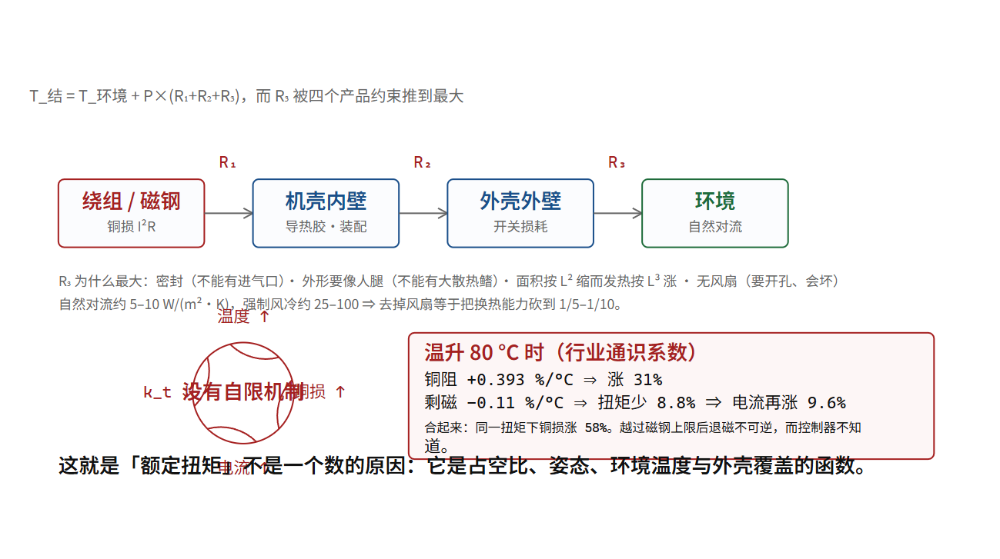

# 热：密封壳里电机与驱动互相加热

## 一个所有线索都指向的空白

从第 02 章起本书就在说同一件事：**宇树全系关节电机、全整个人形产品线，没有任何一处公布“额定（持续）扭矩”。** 只有峰值。

第 04 章给了机理的一半（k_t 随温度漂），第 13 章给了损耗的来源，第 35 章给了电池为什么偏能量那一侧。这一章把它们接完，并且回答那个问题：**为什么这个数不是“不给”，而是“给不出来”。**

> [!QUOTE]
>
> 而且大家可能想象不到，机器人不怕冷，低温没什么问题，但机器人很怕高温。不过很多情况下如果真的热了，它自己趴下休息一会就好了。……我觉得这个可能当下是有些问题，但不是个关键性的问题。
>
> 王兴兴 — 凤凰卫视《X+》专访（主持人田桐），腾讯新闻转载 — 2025-02-21（直接引语（问答按轮次归属））



## 先把热路画出来

一颗关节里的热，从产生到离开机体要走一条串联的路：

```text
磁钢与绕组（铜损发生地）
   ↓  R₁  绕组 → 铁芯 → 机壳
机壳内壁
   ↓  R₂  壳内空气/填充胶 → 外壳
外壳外壁
   ↓  R₃  外壳 → 周围空气（自然对流 + 辐射）
环境
```

串联热路的基本式子，与欧姆定律同形：

```text
T_结温 = T_环境 + P_损耗 × (R₁ + R₂ + R₃)
```

**这条链上最要命的是 R₃。** 因为 R₁、R₂ 是设计者能控制的（加导热胶、把驱动板贴着壳、用铝壳），而 R₃ 取决于**外壳面积与有没有风**。

而一台密封的、IP 防护的、外形要像人的关节，恰好把 R₃ 做到了最大：

| 设计约束 | 对 R₃ 的影响 | 出处 |
|---|---|---|
| 密封（防尘防水） | 不能有进气口 → 只能自然对流 | 第 37 章的 IP 要求 |
| 外形要像人腿 | 表面积不能太大，不能有散热鳍 | 产品定位 |
| 关节要小（第 15 章的 530 g） | 表面积按 L² 缩，而热要按体积（L³）出 | 平方-立方律 |
| 无风扇 | 风扇要开孔、会坏、有寿命 | 可靠性 |

**最后一行有个可算的惩罚：自然对流换热系数约 5–10 W/(m²·K)，强制风冷约 25–100 W/(m²·K)。** 也就是说，去掉风扇等于把换热能力砍到 1/5 到 1/10 [行]。

**把这个系数乘上真实的表面积，就能看到“额定扭矩”为什么必然是一个占空比函数。** 输入是 55 W——本节下面那段会把一颗持续出 60 牛米的膝关节的损耗算成 50–60 W，这里先借它的中值。**但壳得用这颗自己的壳。** G1 的膝是 N7520-22.5，附录 C.2a 记它的外形为 φ75 × 20 mm 级：侧面积 πdL = 0.0047 m²，连两端面 0.0136 m²。第 43 章那台 IM6014 是 φ65 × 60 mm [厂]，侧面积 0.0123 m²，连端面 0.019 m²——**面积大 1.4–2.6 倍，于是温升被算小同样的倍数**，这是借器件最容易犯的一种错，所以两行都摆出来（ΔT = P ÷ (h·A)，P = 55 W）[算]：

| h（W/(m²·K)） | 机理 | N7520 侧面 / 含端面 | IM6014 侧面 / 含端面 |
| --- | --- | --- | --- |
| 8 | 自然对流 | 1,459 / 507 K | 561 / 364 K |
| 13 | 对流 + 辐射 | 898 / 312 K | 345 / 224 K |
| 40 | 强制风冷 | 292 / 101 K | 112 / 73 K |

**三档都不够——可“够”的标准得先钉死，否则这句话是空的。** 本章上面那条热阻链给的预算是 55 W × 1.09 K/W ⇒ **ΔT ≤ 60 K**（结温 100 °C、环境 40 °C）；而绕组绝缘按 F 级 155 °C 那一档，环境 40 °C 时对应 **115 K**。**这两个数不是一回事**：115 K 是“壳到绝缘失效”的绝对上限，60 K 是“壳到绕组热点”的设计预算，中间那 55 K 要留给壳内到热点的 R₁、R₂——热点永远比壳体热。判“够不够”用 60 K 这一档：即使换成**大一号的 IM6014 壳**、再架上风扇（h = 40），也只有 73 K，**仍超 22%**。若只看 115 K 那一档，唯一进得来的恰好是 73 K 这一格，而它需要风扇与开孔，被第 37 章那条 IP 要求和整机外形否掉了。**换个外形、换个判据都改不了结论，这才是“三档都不够”该有的支撑。**

**两处诚实的折扣。** 一，`ΔT = P ÷ (h·A)` 把 h 当常数，可自然对流的 h 随 ΔT 按约 1/4 次幂上升、辐射按 T⁴ − T₀⁴ 走 [行]，所以表里那些几百 K 是**高估**，真实值大约低 1.5–2 倍——高估的方向让“不够”这个结论更稳而不是更脆。二，55 W 里的每一步都含本书假设，两颗关节的外形也都不是产品页给的持续工况。

所以这颗关节**必须把热导进结构**——R₁、R₂ 那条路不是“可选优化”，是唯一走得通的路，机壳只是最后一环；这也解释了为什么本章前面那条 ≤1.09 K/W 的总热阻链里 R₃ 只占一档而不是全部。

**把同一个式子反过来用在整机上，还能得到一条不等式。** 用 G1（第 20 章里三个输入全是一手的那一档）：平均输入约 216 W [算]，假设躯干外壳有效面积 0.35 m²、只有自然对流加辐射（h≈13）、允许 ΔT=45 K：

```text
能散 = h·A·ΔT = 13 × 0.35 × 45 = 205 W
要散 = 216 W           ⇒ 205 ÷ 216 = 0.95：同一量级，几乎没有余量
```

[算]（面积与温差是本书假设，宇树未公布散热结构与降额曲线 [未]）。**这 1.6 倍就是必须三选一的数字理由**：让腿部与躯干外壳一起当散热器、连续作业时主动降平均功率、或者接受风扇与防护等级的代价。本书只给这条不等式，不替厂商选它选了哪一件。

## 一次具体的算术

设一颗膝关节持续输出 60 N·m（以 G1 的膝为例，N7520-22.5；走路时支撑相的量级，第 20 章）。**下面这一串算的是 G1 这一颗关节的损耗，后文 216 W 是同一台 G1 的整机平均输入**——同机对照，所以“一颗关节的热”与“整机的电”这两个量级可以直接相除。

```text
转子侧扭矩 = 60 ÷ 22.5 = 2.67 N·m
所需电流 I = 2.67 ÷ k_t(转子)

k_t(转子) 官方未公布，用第 04 章 M8010 的量级类比：0.10 N·m/A
⇒ I ≈ 27 A（数量级，[算]，输入含假设）

铜损 = I² R = 27² × R
若 R = 0.040 Ω（全书统一口径，见第 09 章；官方未公布 [未]）
⇒ P_cu = 27² × 0.040 ≈ 29 W  —— 单这一颗关节
（旧版此处取 0.05 Ω 得 36 W。相电阻厂商从未公布，所以本书把铜损当 **28–36 W 的区间**，而下面热那一侧保守地按整颗关节 55 W 算——取区间上沿，结论不会因为选哪个 R 而翻）
```

（[算]。）

**而摩擦这一项，官方其实公布了模型与参数——在训练仓库里，不在产品页上。** `unitree_rl_lab` 的 `unitree_actuators.py` 定义了 `UnitreeActuator`（继承 `DelayedPDActuator`），带摩擦模型、延迟与 T-N 曲线限力。源码里的施加式是 [厂]：

```text
τ_friction = Fs · tanh(q̇ / Va) + Fd · q̇        Va 默认 0.01 rad/s
armature   = J2 + J1·i2² + Jr·(i1·i2)²          折算到电机轴的等效惯量（官方定义原文）
限力按 X1 / X2 分段；X1 的官方注释是
   Maximum Speed at Full Torque (T-N Curve Knee Point)  Unit: rad/s
```

（[厂]，逐文件核对；各型号的 X1/X2/Y1/Y2/Fs/Fd/armature 数值见附录 C.2a。）

**这一段推翻本书前面「L、R、J、摩擦、T-N 全部未公布」的说法，必须写实。** 准确表述是：宇树**没有在产品页上**公布这些，但**在训练仓库里公布了**摩擦系数 Fs/Fd、折算惯量 armature、以及完整的 T-N 折点参数。

也就是说，第 08 章那个电压包络与本章那条热阻链，**有一半是能拿到官方数的**——你得去 `unitree_rl_lab` 拿，而不是去 `unitree.com` 拿。

**这本身就是本书的一个方法论结论：一家公司的公开程度，不等于它的产品页的公开程度。** 附录 E 因此把「官方仓库文件」与「官方页面」当作两个可分别引用的证据来源，正文里凡取自仓库的都注明文件路径。

再叠上驱动板（导通损耗 + 开关损耗，量级 5–15 W [行]）与减速器摩擦（10–15% 的通过功率，第 20 章的 0.61 效率），**一颗持续出 60 牛米的关节，内部要散掉约 50–60 瓦。**
**这两个数矛盾吗？不矛盾。** 因为这两个数根本不在同一栏：660 W 是**热**的最坏叠算（12 × 55 W，上面那颗关节在 60 N·m 下总损耗约 55 W：铜损 36 W + 驱动板 5–15 W + 减速器摩擦），216 W 是 **G1 电池侧输入电功率**的平均值。稳态下这 216 W 几乎全部在机内变成热（第 20 章那笔效率账，加上大脑的 40–130 W 也从同一块电池取），所以机内热的平均量级就是三百瓦级；而 660 W 只算关节就已经接近它的两倍，这正说明 12 颗同时、持续、同相位地出 60 N·m 撑不住——真实走路时各关节的力矩是脉冲式的、相位错开的。**但这恰恰是“额定值”难给的原因**：

> **额定扭矩不是一个器件参数，是一个占空比、环境温度、姿态（决定哪几个关节在出力）、以及外壳是否被衣物/护罩覆盖的函数。**

厂商如果印一个“额定 60 N·m”，客户会在夏天、在连续作业、在深蹲姿态下用到降额保护，然后投诉参数不实。**所以不印是理性的。** 而这对客户是坏消息——它意味着**你必须在自己的场景里自己测**。

## 正反馈：那条会自己加速的链

第 13 章提过一次，这里给完整的环：

```text
① 电流 → 铜损 I²R → 温度上升
② 温度上升 → 铜阻上升（+0.393 %/°C）→ 同样电流的铜损更大
③ 温度上升 → 磁钢剩磁下降（NdFeB 约 −0.11 %/°C）→ k_t 变小
④ k_t 变小 → 控制器为维持扭矩命令更大电流 → 回到 ①
```

（系数是行业通识 [行]。）

代 80 °C 温升：

```text
铜阻涨：1 + 0.00393 × 80 = 1.314   ⇒ 铜损涨 31%（同电流）
剩磁降：1 − 0.0011 × 80 ≈ 0.912    ⇒ 同电流的扭矩少 8.8%
⇒ 要维持扭矩，电流要涨 1/0.912 = 1.096，即 +9.6%
⇒ 铜损 = I²R ⇒ 1.096² × 1.314 = 1.58，即铜损涨 58%
```

（[算]。）

**从“冷态”到“热 80 度”，同一扭矩下的铜损涨了 58%。** 这就是为什么“额定”这件事不能只测一次冷机。

而这条链在 ③ 那里有一个**不可逆的出口**：如果温度高到超过磁钢的工作温度上限（N 档 NdFeB 约 80 °C、H/AH 档约 120–150 °C、UH 档约 180–200 °C [行]），退磁就变成**永久**的。此后这台关节的 k_t 永远小了，而控制器不知道——它会一直命令更大的电流去补，于是更热。

**宇树在 IM6014 上官方标“每秒 400 次温度监控” [厂]，`MotorState` 里带 `temperature int16[2]`（两路）[厂]。** 这两条一手事实说明：**厂商知道这条链存在，并且已经在器件里放了两个温度测点。** 而磁钢牌号、工作温度上限、降额曲线，全部未公布 [未]。

## 大脑与关节抢同一份散热

第 26 章说过 Thor 是 40–130 W。现在把它放进热路里：

```text
G1 总电功率约 216 W（平均，[算]）
其中大脑 40–130 W，腿部 12 个关节若干百瓦，感知与通信若干
⇒ 这些电几乎全部在机内变成热（稳态下热 ≈ 输入电功率），要从同一台密封机体里散掉
⇒ 而躯干外壳面积有限
```

**关键耦合：躯干里同时装着电池（第 35 章：4.2 V 三元，热失控起始约 210 °C）、大脑（130 W）、和腰部关节的驱动板。** 而 H2 官方给的双目工作温度是 −20 到 +60 °C / −30 到 +70 °C [厂]——**这是本书在**人形整机页面**上能找到的唯一一处官方温度指标，而且给的是相机，不是关节（器件页另有过热保护与工作温度，见第 15、24 章；整机页没有）。**

相机被放在最外面（头部），因为它最容易热坏，也最容易散热。而关节在结构内部，被衣服、护罩、以及彼此包围。

**所以“夏天在户外干活的机器人”这个场景，卡点不是电池不够，是散不出去。** 环境温度 40 °C、地表 55 °C 时，R₃ 两端的温差预算只剩几十度，而 58% 的铜损增幅（上面算的）已经先发生了。

## 于是本章回答那个问题

**“额定扭矩为什么不公布”的完整答案是三层：**

1. **它不是一个数**：取决于占空比、姿态、环境温度、外壳覆盖情况（上面已证）。
2. **公布它需要暴露设计余量**：额定值 = f(磁钢牌号、热阻、降额策略)。给一个诚实的额定值，等于把这三项告诉竞争对手。
3. **行业没有强制它**：第 37 章会讲，人形目前没有任何一条已发布的强制标准要求厂商标额定扭矩。而汽车与工业伺服都有（因为有过热失效的诉讼史）。

**这三层里，第 1 层是物理，第 2 层是商业，第 3 层是制度。** 而只有第 3 层是可以被改变的——**这就是为什么“人形机器人什么时候有强制安全与性能标准”是一个真问题**（第 37、39 章）。

## 给读者的一个可执行动作

如果你要选一颗关节用在你自己的机器上，**不要问“额定多少”，问这四句**：

```text
① 在环境温度 X °C、外壳安装方式 Y、占空比 Z 的条件下，
   能持续输出多少扭矩而不触发保护？
② 触发保护的温度阈值是多少，在哪里测的（绕组？壳？磁钢？）
③ 磁钢牌号与工作温度上限是什么？
④ 降额曲线有没有？
```

**四个问题里，公开资料通常只能答第 ④ 个的一半。** 而答不出来的那部分，就是你必须自己测的部分。第 40 章的十二个月路线里，“关节温升曲线”是排在很前面的一项，原因就是它是**唯一能自己拿到、而厂商不会给的数据**。

## 类比，以及它在哪儿破

类比：关节像一台被关在没有窗户的房间里的大功率电暖器，而房间还要保持外观整洁。

**这个类比在哪里破，破得很关键**：电暖器的功率是恒定的，而关节的功率**随它多用力而变**，且它用力多少由外部世界决定（今天搬的是 5 公斤还是 20 公斤、地面是平的还是坡）。**所以你不能像设计暖器那样按平均功率散热——你必须按最坏情况，而最坏情况是“客户今天想连续深蹲”。**

这就是为什么工业界管这件事叫**热设计余量**，而余量是重量与成本。一台想卖 8.5 万的机器，它的余量必然比一台卖 45 万的少。**于是“便宜”与“能连续干活”之间有一条热阻构成的硬边界。** 而这条边界，恰好是宇树在招股书里主动“放弃工业重载与连续作业”这个选择的物理理由 [推]。

---

**一个可检验的说法**：关节热路由 R₁（绕组到壳）、R₂（壳内到外壁）、R₃（外壁到环境）串联构成，而密封、无风扇、外形受限、面积按 L² 缩而发热按 L³ 涨这四项约束共同把 R₃ 推到最大（自然对流换热系数约为强制风冷的 1/5–1/10）；以一颗持续出 60 N·m 的膝关节估算，铜损约 36 W、含驱动与摩擦约 50–60 W；把这 55 W 只靠壳面散出去，用这颗膝自己的外形（N7520 φ75 × 20，侧面积 0.0047 m²）与自然对流 h = 8 得 **1,459 K**，换成第 43 章那颗 IM6014 的 φ65 × 60（0.0123 m²）也得 **561 K**——**同一颗关节借了别人的壳，结论会好 2.6 倍，所以外形必须写明是哪一颗**；对着 60 K 的设计预算（55 W × 1.09 K/W）三档全超，连“大壳 + 风扇”那一格也有 73 K；对着 115 K 的绝缘上限，唯一进得来的正是那一格，而它被 IP 要求否掉了；温升 80 °C 时铜阻涨 31%、剩磁降 8.8%、同扭矩下铜损涨 58%，而超过磁钢工作温度上限后退磁不可逆；因此“额定扭矩”不是一个数而是占空比、姿态、环境温度与外壳覆盖的函数，这是厂商不给它的第一层原因。

**证据等级**：热路串联模型、自然对流与强制风冷系数、NdFeB 温度系数与牌号工作温度、铜阻温度系数，全部是传热与电机设计通识 [行]；所有数值（27 A、36 W、50–60 W、660 W、31%、8.8%、58%、0.0047 / 0.0136 m²、1,459 / 507 / 898 / 312 / 292 / 101 K、561 / 364 / 345 / 224 / 112 / 73 K、60 K、115 K、22%、205 W、1.6 倍）是 [算]，**输入含本书假设（k_t 类比 M8010、R = 0.05 Ω、减速比 22.5、占空比、躯干外壳 0.35 m² 与 ΔT 45 K）**，宇树未公布 G1/H2 关节的 L/R/k_t/热阻/降额曲线 [未]；两颗关节的外形（N7520 φ75 × 20 级、IM6014 φ65 × 60 mm [厂]）取自附录 C.2a 与第 43 章那张表，**“级”表示只到量级、官方未给完整包络** [未]；两个 ΔT 判据（60 K 设计预算 = 55 W × 1.09 K/W；115 K = F 级 155 °C − 环境 40 °C）都是本章自己的除法，二者的差是 R₁ + R₂ 上那段热点温差 [算]；h 随 ΔT 上升（自然对流约 1/4 次幂、辐射按 T⁴ − T₀⁴）故表中大 ΔT 为高估，是传热通识 [行]；“每秒 400 次温度监控”、`temperature int16[2]`、H2 双目 −20~+60 / −30~+70 °C [厂]；216 W 与 6.2 W/kg 来自第 20 章（G1，三个一手数相除）[算]；H1/H2 不给瓦数；“厂商不公布额定值的三层原因”与“便宜与连续作业之间有热阻边界”是本书论证 [算][行]，其中招股书口径为 [推]。

**可核对清单**：

- [ ] 自己算一次那条正反馈：取温升 60 °C，铜损涨多少（提示：(1/0.934)² × (1+0.393×0.6) − 1）
- [ ] 用 ΔT = P·R_th 反推：若允许结温 100 °C、环境 40 °C、损耗 55 W，需要的总热阻是多少（答：≤1.09 K/W），再判断一个 530 g 的密封铝壳能不能做到
- [ ] 在宇树 G1/H1/H2 页面搜“额定 / 持续 / rated / 降额 / derating / 工作温度 / 热”，记录你能找到的每一项（预期：只有相机的温度）
- [ ] 找一个工业伺服的样本（任何品牌），看它的额定扭矩旁边有没有一张降额曲线图——那张图就是人形现在缺的东西

**下一章**：本章说热决定了“能不能连续干活”。下一章去看另一件事：当这台 70 公斤的机器出问题时，它怎么停下来——以及为什么“停下来”这件事需要设计。
