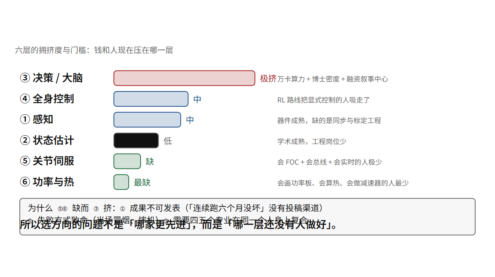

# 行业分工与人才缺口：谁在做什么，缺什么人

## 同构的技术栈，分歧的三处

先给本章最重要的一张表。三家中国头部公司，逐层对照（宇树官方项标 [厂]，另两家一律 [查]——图例里 [厂] 只留给宇树；来源见附录 E）：

| 层 | 宇树 | 智元 | 银河通用 |
|---|---|---|---|
| ① 感知 | 深度相机 + 3D 雷达；自研 L1/L2 | 头双目 + 腕 RGBD + 鱼眼 + 雷达 + 超声；**全关节力矩传感器** | 头双目 + 躯干 4 相机 + 腕深度 + 六维力 + 雷达 |
| ② 状态估计 | 双 IMU 字段 | 未公开细节 | 未公开细节 |
| ③ 决策 | UnifoLM 一族（WMA/VLA/WLA，6B） | GO-1 / GO-2（InternVL2.5-2B + MoE / ACoT-VLA） | AstraBrain（WAM + WBC 0.5）+ GraspVLA |
| ④ 全身控制 | 公开工序是 RL（rl_gym / rl_lab） | 未公开 | AstraBrain-WBC 0.5（2 亿帧 / 2 万小时 / ONNX 端侧） |
| ⑤ 关节伺服 | 自研电机，RS-485 4–6 Mbps | 自研 PowerFlow，EtherCAT 1 kHz ↔ 3×CAN-FD | **完全未公开** |
| ⑥ 功率与机械 | 两级行星（拆解）/ 型号名 14.3–22.5 | 准直驱 + 高透明度行星 + 液冷（宣称替代谐波使 BOM ↓30%）| 未公开 |
| 中间件 | 裸 CycloneDDS + ROS 2 适配 | 自研 AimRT / 灵渠 Link-U OS | 自带 GalbotSDK |
| 大脑硬件 | Orin NX 16 GB / Thor T5000 | AGX Orin 64 GB + x86 工控；A3 加 Thor | AGX Orin 64 GB |
| 数据来源 | 开源生态 + 遥操（HF 约 200 集） | **真机数采工厂**（百万轨迹） | **仿真合成约 99%** |
| 整机价格 | G1 ¥8.5 万起 / H2 ¥19.9 万 | 精灵 G1 45 万 / X2 青春版 9.8 万 | 不公开，走行业订单 |

**这张表最该被读出来的不是差异，是同构。**

十行里，前八行三家几乎在做同一件事：同样的传感器类别、同样的 MCU+FOC+现场总线、同样的“VLM 主干 + 动作专家”、同样的 Orin/Thor。**分歧只在最后两行：数据从哪来、以及卖给谁。**

**这个观察的实际价值是：如果你要选一个职业方向，“哪家用的技术更先进”是错问题；“哪一层还没有人做好”是对问题。**

> [!QUOTE]
>
> 在 AI 领域，没有一家大公司能保证，只要有足够的人、有足够的资源，我就能永远领先。OpenAI 和 DeepSeek 已经证明了，AI 的创新永远伴随着一些随机性，伴随着更多的聪明年轻人的。
>
> 王兴兴 — 王兴兴 2025 世界机器人大会主旨演讲（新浪“机器人前瞻”文字实录） — 2025-08-09（第一人称演讲逐字）



## 往下追一层：为什么偏偏是这三处分叉

同构表里那三行（大脑硬件、关节伺服、中间件）不是并列的三条品味差异，它们各自有一个能算的理由。而把理由算出来，才知道每一层要什么样的人。

**一，大脑层被锁死，锁的是软件栈，不是芯片。** 先看硬件为什么不是理由：一个 6B 参数的模型，权重字节是 6 × 10⁹ × 2 B = 12 GB（FP16），单步推理的时间下限是

t ≥ 权重字节 ÷ 内存带宽

第 26 章按这条式子给过一整列：带宽 41.6 GB/s ⇒ 12 ÷ 41.6 = 288 ms，100 GB/s ⇒ 120 ms，273 GB/s ⇒ 44 ms [算]——**同一颗“算得快”的芯片，如果带宽不够，模型就是在等内存而不是在算**。而换芯片真正要换掉的东西在后面：训练侧，官方 `unitree_rl_lab` 的 README 把环境钉在 Isaac Sim 5.1 + Isaac Lab 2.3 [厂]，上一代 `unitree_rl_gym` 钉的是 NVIDIA 已经终止支持的 Isaac Gym Preview 4 [厂][查]，官方仓库只在 3080 / 3090 / 4090 上测过、RTX 50 系要换 Isaac Sim 5.0.0 [厂]；部署侧，模型导出走 ONNX / TensorRT（第 30 章）[厂]；生态侧，能直接接进来的开源策略是 GR00T 与 π0.5 这一族（第 32 章）[查]。**换掉 NVIDIA = 同时换掉训练环境、推理运行时、算子与量化工具链、以及所有别人已经训好的模型**。这就是“锁死”的确切含义：Orin → Thor 的升级路径之所以只能跟着它的节奏走（官方给的口径是 Thor T5000 2070 TFLOPS（FP4-Sparse）与 Orin NX 100 TOPS（INT8），两个数不可比 [厂]，第 26 章），不是因为别的芯片跑不动，是因为换过去这些数全都要重做一遍。

**二，关节层是劳动密集，因为位时间不允许把环路挂在总线上。** 这是本节唯一一条能一行算完的硬理由。开源参照实现 ODrive 的官方口径是环路周期恒定 125 µs（8 kHz）、CAN 2.0b 跑 1 Mbps [查]。同一时间窗里总线能搬多少？一帧下行 17 字节，按 8N1（1 起始 + 8 数据 + 1 校验/停止位的常见串口开销，本书在第 27 章用的就是这个口径）是 17 × 10 = 170 bit，在 1 Mbps 上就是 170 µs：**170 ÷ 125 = 1.4 倍——一帧还没发完，环路已经要闭第二次。** 所以电流环在数学上就不可能由上位机通过总线闭合，它只能长在关节自己那颗 MCU 里。另一家参照实现 moteus 的官方口径把这个结论反过来写成了规格：5 Mbps CAN-FD、控制环 15–30 kHz、PWM 默认 30 kHz [查]——33 µs 一个开关周期，而 5 Mbps 的位时间是 200 ns，一帧 17 B 在这个速率上是几十微秒量级（本书用同一个 170 bit 口径粗算得 34 µs；CAN 的位填充与帧开销另计，这里只取同量级 [行]），**于是又是“一帧 ≈ 一个环”的比例**。宇树自己的数也是同一族：官方文档给 M8010 的帧长是下行 17 B、上行 16 B、总线 4 Mbps [厂]，脚本拿 23 台全双工 1 kHz 算得需要 6.07 Mbps、反过来 4 Mbps 最多撑 659 Hz（`foc_check.py bus_budget(nodes=23, hz=1000)`）[算]，而官方 Z1 页标的控制频率是 1 kHz [厂]——**这两件事只能同时成立的方式，是 1 kHz 那条给外环，内环在本地**（帧格式细节官方未公布 [未]）。

于是关节层的工程量是按“颗”计的：G1 官方 23 个自由度 [厂]，每一颗关节都要 1 台 MCU + 6 只功率管（三相半桥，第 08 章那六个矢量）+ 1 只栅极驱动 + 1 套编码器 + 1 路总线收发器，再加一整套要自己调的 FOC 参数与第 13 章那三类失效判据。23 × 6 = **138 只功率管，每只都要过一遍死区与采样时刻这一关。** 这一层不缺算力、不缺融资叙事，缺的是把 23 份一模一样的板子都调到能出扭矩且不发热的耐心——**所以它是劳动密集，所以供应商遍地，所以它的门槛在器件层而不在资金层。** 这也是本章标题那句“器件层决定谁能进入这行”的第一层意思。

那这一层为什么不能用钱压平？把三个数并排放就知道它卡在哪：

一帧 17 B × 10 bit = 170 bit ⇒ 在 1 Mbps 上要 170 µs，而 ODrive 的环路周期只有 125 µs——**帧比环长，内环只能就地闭**

23 台 × (17 + 16) B × 1 kHz × 8 = 6.07 Mbps ⇒ 需要官方 4 Mbps 的 1.5 倍，反解上限只有 659 Hz（`foc_check.py bus_budget(nodes=23, hz=1000)`）

23 个关节 × 6 只功率管 = 138 只 ⇒ 而大脑侧只有 1 块 SoC，**工程量的分母差 138 倍**

**这三行里没有一行是算力问题**：买更多 TOPS 不会让 170 µs 变成 100 µs，也不会让第 138 只功率管自己学会不直通。它们只能一份一份地调。这就是“劳动密集”四个字的算术内容。

**三，中间件在去 ROS 化，岗位含义跟着变。** 第 28 章已经核实：宇树的核心 SDK 不依赖 ROS，它是裸 CycloneDDS 的主题与服务，ROS 2 只是另外提供的一层适配（还要自编 cyclonedds 0.10.2 并设 RMW）[厂]；智元自研 AimRT 与灵渠 Link-U OS [查]；银河通用的公开文档里根本没有 ROS/DDS 这一层 [厂]。**去 ROS 化不是厂商傲慢，是“关键路径是确定性的时候，抽象层要付利息”**（第 28 章原话）。它对求职者的实际含义很具体：这一层要的人得能读 DDS 的 QoS 语义、能接受“上一帧根本没到过”这个默认假设，而不是会跑 ROS 教程里的例程。

## 一条判据：技能要能对账，不能对口号

把上面三层换成可核对的岗位—技能对应表。**每一格都写“你拿什么证明你会”，而且那个证明是一次代数**——因为这一行的面试里，说“我熟悉 FOC”不算任何东西，把 i_q 与扭矩对上手才算。

| 岗位 | 这条技能的可复算判据 | 对应章 |
|---|---|---|
| 关节伺服 / 电机控制 | 能判手册扭矩常数的口径：0.63895 N·m/A × 40 A = 25.56 N·m，与官方峰值 23.7 N·m 差 +7.8% ⇒ 它是**输出端**口径（转子端是 0.10094） | 04 |
| 同上 | 能算电压包络：E = (2/3)·k_t·ω = (2/3) × 0.10094 × 189.9 = 12.78 V（幅值不变约定），24 V 母线的 SVPWM 线性区给 24 ÷ √3 = 13.86 V ⇒ 空载够、满载（+40 A × 40 mΩ = 14.38 V）不够 ⇒ 峰值扭矩与最高转速是两个角点，不能同时取 | 08 |
| 同上 | 能算死区：(100 ns ÷ 50 µs) × 24 V = 48 mV，并说清它为什么在过零点最疼 | 13 |
| 同上 | 能把合成磁场讲成一句话：三相互差 120° 的正弦，合成矢量幅值恒等于相电流峰值，方向由各相导通时间比决定 | 07、08 |
| 嵌入式实时 | 能读帧与位时间：4 Mbps ⇒ 1 bit = 1 ÷ (4 × 10⁶) = 250 ns；一帧 17 B（8N1）= 170 bit ⇒ 42.5 µs | 12、27 |
| 嵌入式实时 | 能做总线预算：15 台 × 6 kHz × (17 + 16) B = 23.76 Mbps，是官方 4 Mbps 的 5.9 倍；反解上限 1010 Hz | 27 |
| 结构与传动 | 能找精度地板：360 ÷ 32768 ÷ 20.58 = 0.000534°，而背隙 6 弧分 = 0.1°，是它的 187 倍 | 14 |
| 运控 / RL | 能用官方数闭环 kp：ω_n = √(kp ÷ armature) = √(99.098 ÷ 0.02510) = 62.8 rad/s = 10.0 Hz，与官方注释一致 ⇒ kp 是反推出来的不是手调的 | 18 |
| 热与可靠性 | 能算热漂移闭环：1 + 0.00393 × 80 = 1.314（铜阻）与 1 − 0.0011 × 80 = 0.912（剩磁）⇒ 同扭矩铜损涨 58% | 36 |
| 电源与电池 | 能判断电芯化学：75.6 V ÷ 18 串 = 4.20 V/颗（终止）、0.972 kWh ÷ 15 Ah ÷ 18 = 3.60 V/颗（标称）⇒ 不是磷酸铁锂；能算母线塌陷为什么会让 MCU 复位 | 35 |
| 数据与工具链 | 能算同步误差的代价：20 ms 不同步在 1 m/s 相对运动下 ≈ 13 像素伪视差，是 0.5 像素测距精度的 27 倍 | 23、33 |
| 评测与安全 | 能算复合衰减与置信：0.99^100 = 36.6%，而 10 次里成 7 次的 95% 区间宽到 ±28% | 37、38、40 |

**这张表里没有一个数字来自招聘市场。** 它给的是“会”这个字的最低标准：能拿官方公布的数做一次代数，并说清这一步在算什么。**它的用法是反向的——去面试别人也照这张表问：如果对方连 k_t 的口径都判不出来，他对这台机器的所有判断都要打折。**

**边界照旧要写在正文里**：以上关于“谁缺、谁挤”的全部内容都是行业观察 [行]，不是事实陈述；本书不给岗位数量、薪资区间、缺口人数这一类数，因为**没有可核来源** [未]——本章宁可空着也不填，这本身就是它想教的那件事。

## 这条链在哪里断：门槛低不等于这层好做

上面把关节层说成“劳动密集、供应商遍地”，很容易被读成“这层没难度”。恰恰相反，它的难度都以**不可见**的形式存在，而这正是它缺人的根因。

第一，**上限不是被物理顶住的，是被文档顶住的。** 你要调一颗关节，需要 L、R、k_t、齿隙、T-N 折点、热阻这一整张参数表——第 15 章已经核过：产品页给不出这些，官方训练仓库给得出摩擦与折算惯量，而电气那一半（相电阻、电感、死区、母线电容）至今未公布 [未]。**结果是这一层的工程师必须在信息不完备的条件下做判断，而且没人教他怎么标不确定度。** 追问一句：那这类判断力从哪来？只能从“自己画过板、自己烧过件”来——它不可速成，也没有发表渠道，这正是第 39 章开头那条“成果不可发表”的另一面。

第二，**代价是延迟暴露的。** 死区补偿没调好，演示里看不出问题，八个月后磨损与油膜变化把它放大（第 38 章那条漂移链）；齿隙当年 6 弧分、跑一年翻倍，位置误差带跟着翻倍 [算]。而这一层的失效表现是冒烟、摔机、伤人，当场兑现（第 13、37 章）——**做砸的代价高到必须实物练，实物练的门槛高到人学不会**，这是一个自锁的环，比任何薪资数字都更能解释为什么这层缺人。

第三，**“器件层决定谁能进入这行”这句话有一个反例要写出来。** 如果一个人只有算力与钱，他可以买 Orin、租万卡、跑现成模型，在 ③ 层迅速产出可发表的东西；而他买不到“23 颗关节同时不抖”这件事——那 23 份调试工时只能一份一份花。所以 ⑤⑥ 层的进入门槛低（一张 STM32G4 与几颗功率管的钱，第 40 章给量级），而**天花板高且不可用钱压缩**。这两句合起来才是本章的职业结论。

## 六层各自的拥挤程度

把行业投入（钱与人）按本书的六层排一下：

```text
① 感知      中   —— 器件成熟，缺的是同步与标定工程
② 状态估计  低   —— 学术成熟，工程岗位少
③ 决策      极挤 —— 万卡算力 + 博士密度 + 融资叙事中心
④ 全身控制  中   —— RL 路线把显式控制的人吸走了
⑤ 关节伺服  缺   —— 会 FOC + 会总线 + 会实时的人极少
⑥ 功率机械  最缺 —— 会画功率板、会算热、会做减速器的人最少
```

**为什么 ⑤⑥ 缺而 ③ 挤？** 三个原因，都很实在：

**一、门槛的可见性。** ③ 有论文、有开源权重、有排行榜，做了就能被看见。⑤⑥ 的成果是“这台机器连续跑了六个月没坏”，**没有发表渠道**。

**二、失败的方式。** ③ 做砸了是指标低；⑤⑥ 做砸了是**冒烟、摔机、伤人**，而且是当场。这决定了它需要的是有过实物经验的人，而实物经验不可速成。

**三、技能的复合性。** 第 1 部十章讲的东西，在现实里分属四个专业：电磁与电机设计、电力电子、嵌入式实时、控制理论。**一个同时懂这四样的人，在任何一家公司都是稀缺资源；而只懂其中一样的人很多。**

（本章不给“缺多少人”这类数，因为公开可核的数不存在 [未]。给的是判据与原因，比数更耐用。）

## 三家的钱押在哪，说明他们各自认为瓶颈是什么

```text
宇树：募资约 42 亿元 —— 20.22 亿具身模型、11.1 亿本体、6.24 亿制造基地
      （这三项之和 37.56 亿，其余 4.44 亿未见项目级拆分，本书不硬凑）
      产能规划：7.5 万台双足 + 11.5 万台轮式
智元：量产 2025-01 破千台 → 2026-06 第 15,000 台；2026 目标 1,000 万小时有效数据
      2026-07 启动港股 IPO
银河通用：估值 >230 亿元、已完成股份制改造；客户含宁德时代、博世、丰田、北汽、
         上汽、极氪、西门子；S1 在某基地 7×24 无遥操 3→6 个月
```

（全部 [查][推]，媒体与厂商口径混合。）

**读这三段的方式是问“钱换的是什么”：**

- 宇树用一半的钱买**模型能力**，用另一半买**产能**——它认为自己的躯体已经够好。
- 智元把目标写在**数据小时数**上——它认为瓶颈在数据（第 33 章）。
- 银河通用把叙事写在**客户名单与无遥操时长**上——它认为瓶颈在场景落地（第 38 章）。

**三种判断都合理，而它们互不兼容。** 这就是这个行业还没有共识的证据。**对读者的含义：不要因为某家公司的选择而认定那是唯一的路。**

## 三家共同承认的两个短板

这是本章最有价值的一节，因为它是**竞争者难得一致**的地方。

**一、可靠性与室外防护。** 智元公开承认续航、稳定性、速度、室外防护不达标；宇树在招股书里主动“放弃工业重载与连续作业” [推]。**两家分别承认了自己最弱的那一面，而它们指向同一处：这台机器还不能在脏、湿、重、连续的环境里干活。**

第 23 章（100 Klux 边界）、第 35 章（电压塌陷）、第 36 章（热）、第 37 章（没有强制标准）、第 38 章（漂移）——**本书已经用五章证明了这不是宣传话术，是物理与制度的复合结果。**

**二、数据。** 三家在路线上分歧，但对“数据不够”没有异议。而“不够”的具体含义，第 33 章给过：任务异质、分布割裂、没有可信的“真机等价于多少仿真”换算比。

## 一个空白，和一个位置

把上面所有场景清单列一遍：厨房、桌面、货架、办公室、仓库、装配台、药房。**共同点是室内、平整、光照可控、物体人造、负载轻。**

**没有任何一家公开拥有**：非平整地面、坡地、作物行之间、泥、雨、正午强光下、以及 50 公斤级负载的连续作业数据。

本书不主张“所以你应该去做农业机器人”——那是建议，不是事实。本书只指出一个可核实的结构：**这是当前所有公开数据集的一个共同空洞，而填它需要的不是算力，是场景准入。**

（场景准入 = 你能连续几周在同一块地里操作一台机器，且这台机器坏了你自己能修。这件事的门槛不在技术，在**你能不能长期待在那个场景里**。）

## 一张“我该往哪一层走”的判据表

| 你现在的背景 | 最短路径进入的那一层 | 为什么 | 需要补的（对应章节） |
|---|---|---|---|
| 嵌入式 / 单片机 / 电机控制 | ⑤ 关节伺服 | 语法相同，只是对象从风扇/云台变成机器人关节 | 级联三环（12）、总线预算（27）、实时性测量（22） |
| 电力电子 / 电源 | ⑥ 功率与热 | 你已经在处理同量级的损耗与热 | 齿隙与传动（14）、热阻链（36） |
| 机械 / 车辆 / 农机 | ⑥ 结构与传动 | 你已经懂刚度、模态、疲劳 | 准直驱取舍（14）、平方-立方（02） |
| 软件 / 后端 / 基础设施 | 数据与工具链（33） | 这一层缺的是工程化能力，不是算法 | 数据格式与质检（33）、评测协议（38） |
| 算法 / 深度学习 | ③ 决策，或 ④ 运控 RL | 迁移最近 | **必须补 ⑤⑥**，否则你会写出物理上不能执行的策略（04–15） |
| 测试 / 质量 / 安全 | 贯穿 ①–⑥ 的可靠性与合规（不是第七层） | 全行业最少人、且第 37 章显示制度即将出现 | 全书第 5 部 |

**这张表里唯一一条硬建议是第五行的加粗部分。** 一个只做 ③ 的算法工程师，如果不知道 τ = k_t·i 的口径陷阱（第 04 章）、不知道电压包络让角点互斥（第 08 章）、不知道齿隙是精度的地板（第 14 章），他会持续产出**在物理上无法执行的动作指令**，而且不知道为什么被拒。**这是本书第 1 部存在的职业理由。**

## 类比，以及它在哪儿破

类比：这个行业像 1995 年的互联网——基础设施缺、应用不缺想法、而所有人都在赌哪一层会赢。

**这个类比在哪里破，破得最重要**：1995 年的互联网，硬件（TCP/IP、光纤、CPU）是**已经存在且免费可用**的，所以创业全压在应用层。而人形机器人的硬件**每一层都还没稳定**：关节参数表不完整（第 15 章）、总线要自己定协议（第 27 章）、电池化学要自己选（第 35 章）、安全标准不存在（第 37 章）。

**所以这个行业不可能只靠应用层创业成功。** 它需要的人，是愿意去做那些“不性感、不能发表、会冒烟”的层的人。而本书第 1 部之所以用十一章讲一颗关节，就是这个原因：**那是这个行业里最不被讨论、而最决定成败的一层。**

---

**一个可检验的说法**：宇树、智元、银河通用在感知、状态估计、决策架构、关节伺服、功率机械、中间件六层上高度同构，分歧只在数据来源（开源生态 / 真机数采工厂 / 仿真合成）与客户定位；三层的分工由器件层的算术决定而不是由融资叙事决定——大脑层被锁死的是软件栈（6B × 2 B = 12 GB 权重，带宽 41.6–273 GB/s 决定单步 288–44 ms，而训练侧钉在 Isaac Sim 5.1 + Lab 2.3、部署侧走 ONNX/TensorRT、生态侧接 GR00T 与 π0.5，换芯片要同时重做这四件事），关节层是劳动密集（一帧 17 B 按 8N1 是 170 bit，在 1 Mbps 上要 170 µs，而 ODrive 的环路周期是 125 µs：**帧比环长，所以电流环只能长在关节自己的 MCU 里**，于是 G1 的 23 个自由度就是 23 份固件与 23 × 6 = 138 只功率管的调试工时），中间件在去 ROS 化（宇树核心是裸 CycloneDDS，智元自研 AimRT / Link-U OS，银河通用公开文档里没有这一层）；三家分别把资金押在模型能力、数据小时数、场景落地三件不同的事上，说明行业对瓶颈没有共识；而三家共同承认可靠性与室外防护不达标，且没有任何一家公开拥有田间/重载/非结构化环境的操作数据；从人才看 ⑤⑥ 层最缺而 ③ 层最挤，原因是成果不可发表、失败方式致命、且需要四五个专业的复合。

**证据等级**：三家逐层规格取自各家官方页面、文档中心、GitHub 与 arXiv：宇树的记 [厂]，另两家的记 [查]；12 GB 与 288–44 ms 沿用第 26 章的 [算]（其中内存带宽 41.6 GB/s 那档的位宽是本书假设 [未]）、Isaac Sim 5.1 / Lab 2.3 与 Isaac Gym Preview 4 终止支持 [厂][查]、GPU 实测型号与 RTX 50 需 5.0.0 [厂]、ONNX/TensorRT 导出 [厂]、GR00T 与 π0.5 生态 [查]；ODrive 环路周期 125 µs（8 kHz）与 CAN 2.0b 1 Mbps、moteus 5 Mbps CAN-FD / 15–30 kHz 控制环 / 30 kHz PWM（= 33 µs）、位时间 200 ns 与一帧 34 µs，均为参照实现的官方口径 [查]；M8010 帧长 17 B / 16 B、总线 4 Mbps、Z1 控制频率 1 kHz、G1 23 DoF [厂]；6.07 Mbps、659 Hz、23.76 Mbps、5.9 倍、1010 Hz、250 ns、42.5 µs、138 只功率管、170 ÷ 125 = 1.4 倍，以及判据表里每一行的代数，是 [算]（`foc_check.py` 的 kt_crosscheck / voltage_envelope / deadtime_error / resolution_vs_backlash / bus_budget / natural_frequency_check 与本书手核）；募资与产能分配、量产台数、估值、客户名单、无遥操时长 [查][推]，**多为媒体与厂商口径混合，本书未独立核实**；“六层拥挤度”“三个原因”“器件层决定谁能进入这行”是行业观察 [行]，**本书不提供岗位数量、薪资与缺口人数，因为无可核数据** [未]；宇树关节总线的条数与拓扑未公布 [未]，而拆解口径与官方口径在“485 还是 CAN”上直接冲突，两条都保留（第 27 章）；判据表各行的技术依据回指对应章节。

**可核对清单**：

- [ ] 打开三家官网，各自找一款旗舰人形，把上表十行自己填一遍，记下哪几行三家都写不出来（预期：⑤ 层细节）
- [ ] 自己算一次 17 × 10 ÷ 10⁶（1 Mbps 下一帧多少微秒），再与 125 µs 比一比，体会“帧比环长”
- [ ] 跑 `python -X utf8 code/tools/foc_check.py`，把判据表里那六条代数逐条对上脚本输出
- [ ] 用 12 GB ÷ 100 GB/s 复算 120 ms，然后想清楚：这条式子里哪个量是你换芯片能改的、哪个不能
- [ ] 找 5 个机器人公司的“运动控制/执行器”岗位 JD，数一数它们要求哪些第 1 部的能力；再找 5 个“大模型算法”JD 做同样件事
- [ ] 用第 04、08、14 章的三个判据（k_t 口径、电压包络、齿隙地板）去检查一份你正在用的关节参数表
- [ ] 想清楚你选的那一层，它的成果**能不能被发表**；如果不能，你是否有别的方式让它被看见（第 40 章）

**下一章**：本章给了地图与判据。最后一章把它们变成一条十二个月、每步都有可测产物的路线——这是本书唯一一章，读者需要拿支笔在上面打勾。
